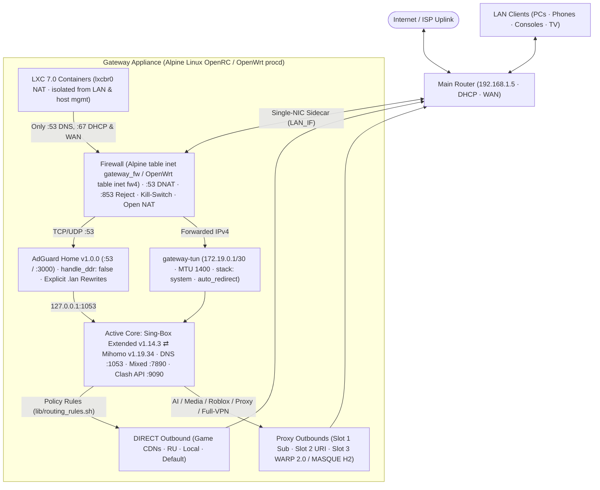
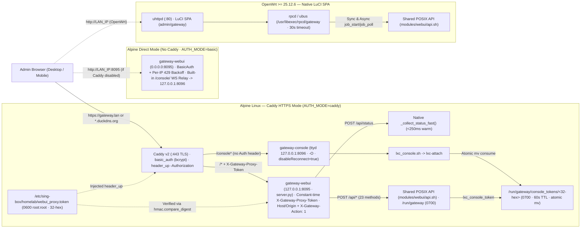
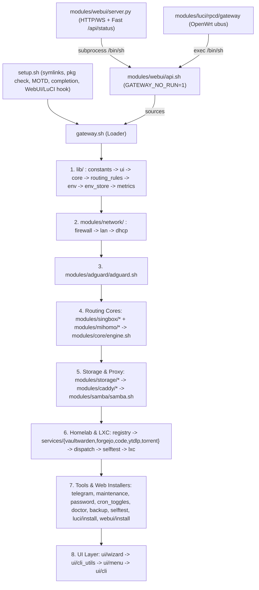

# 🏛️ Architecture & Maintainability Blueprint

> **Revision:** November 22, 2026 (Phase-2 Baseline `v2026.11.2`).
> **Supported Platforms:** **Alpine Linux `3.23–3.24+`** (`OpenRC` + `apk-tools v3` + cgroups v2) and **OpenWrt `>= 25.12.6`** (`procd` + `fw4` + `apk-tools 3.x` + native LuCI SPA). Zero Docker runtime, zero `systemd`, zero legacy `opkg`.

This document is the canonical technical blueprint for **Universal Sidecar Gateway & Homelab**. It covers traffic and authentication flows, port/path/service inventories, module dependencies, dual-core routing internals, and 5-minute extension recipes.

---

## 1. Dual-OS Platform Profiles

The entire codebase runs from `/opt/gateway` (registered as `/usr/bin/gw` and `/usr/bin/gateway`) over a unified POSIX `sh` OS abstraction in `lib/core.sh` (`detect_os()`, `is_openwrt()`, `version_ge()`, `service_ctl()`):

| Subsystem | Alpine Linux (`3.23–3.24+`, OpenRC) | OpenWrt (`>= 25.12.6`, `procd` + `fw4`) |
|---|---|---|
| **Routing Core** | Sing-Box Extended `v1.14.3-extended-2.7.3` ⇄ Mihomo `v1.19.34` | Sing-Box Extended `v1.14.3-extended-2.7.3` ⇄ Mihomo `v1.19.34` |
| **Clash-API UI (`:9090/ui`)** | Zashboard `v3.30.0` ⇄ MetaCubeXD `v1.275.2` | Zashboard `v3.30.0` ⇄ MetaCubeXD `v1.275.2` |
| **DNS Appliance** | AdGuard Home `v1.0.0` (`:53`/`:3000`, `handle_ddr: false`, 14 explicit `.lan` rewrites) | AdGuard Home `v1.0.0` (`:53`/`:3000`, `dnsmasq` set to `port='0'`, 6 explicit `.lan` rewrites; LuCI `:80` preserved) |
| **Management Web UI** | Native Python 3 Web Dashboard (`gateway-webui :8095`) + `ttyd` Console (`:8096`) | Native LuCI SPA (`luci-app-gateway` under `admin/gateway` via `/usr/libexec/rpcd/gateway`) |
| **Firewall & Kill-Switch** | `/etc/nftables.nft` (`table inet gateway_fw`) + `lxcbr0` isolation | `/etc/nftables.d/90-gateway.nft` (chains inside `table inet fw4`, `fw4 check` rollback) |
| **Boot Guard** | `/etc/local.d/50-gateway-boot-guard.start` | `/etc/rc.local` |
| **Homelab, Caddy SSL/PKI, LUKS2 & LXC 7.0** | ✅ Full suite (7 modules + `/srv/storage/Shared` + LXC Studio) | ⛔ Excluded by design (`require_alpine_feature` / `is_openwrt` guards) |

---

## 2. End-to-End Traffic, DNS & Firewall Flow



---

## 3. Web Dashboard, Caddy, `ttyd` & LuCI Authentication Flow



---

## 4. Complete Reference Inventory

### 4.1 Ports, Bind Addresses & Firewall Policy

| Port | Proto | Service | Bind Address | Firewall Policy |
|---|---|---|---|---|
| `22` | TCP | SSH (`sshd` / `dropbear`) | `0.0.0.0` | Allowed from LAN; **blocked** from `lxcbr0` |
| `53` | TCP/UDP | AdGuard Home DNS | `0.0.0.0` | Allowed from LAN & `lxcbr0`; intercepted by `:53` DNAT |
| `67` | UDP | DHCP (optional AGH / `lxcbr0` dnsmasq) | `0.0.0.0` / `lxcbr0` | Allowed for DHCP discovery (`lxcbr0` allowed) |
| `80` | TCP | Caddy HTTP (`ca.lan` PKI / HTTPS redirect) · OpenWrt LuCI (`uhttpd`) | `0.0.0.0` | Allowed from LAN (Alpine); preserved for LuCI (OpenWrt) |
| `443` | TCP/UDP | Caddy HTTPS (`*.lan` / `*.duckdns.org`) | `0.0.0.0` | Allowed from LAN (Alpine only) |
| `445` | TCP | Samba SMB2/SMB3 (`smbd`) | `lo` + `${LAN_IF}` | LAN RFC1918 only (`hosts allow`); **blocked** from `lxcbr0` |
| `853` | TCP/UDP | DoT / DoQ (anti-bypass) | — | **Explicitly rejected** on input and forward (`LAN_IF` + `lxcbr0`) |
| `1053` | TCP/UDP | Active Core DNS (`sing-box` / `mihomo`) | `127.0.0.1` | Loopback only (upstream of AdGuard Home) |
| `3000` | TCP | AdGuard Home Web Panel | `0.0.0.0` | LAN RFC1918 only; **blocked** from `lxcbr0` & non-RFC1918 |
| `3001` | TCP | Forgejo Git | `127.0.0.1` | Loopback only (via Caddy `https://forgejo.lan`) |
| `3702` / `5357` | UDP / TCP | WSDD (Windows 10/11 SMB Discovery) | `${LAN_IF}` | LAN RFC1918 + multicast `239.255.255.250` |
| `5353` | UDP | Avahi mDNS (Linux/macOS Discovery) | `${LAN_IF}` | LAN RFC1918 + multicast `224.0.0.251` |
| `7890` | TCP/UDP | Active Core Mixed Proxy (HTTP/SOCKS5) | `0.0.0.0` | LAN RFC1918 only |
| `8081` | TCP | MeTube (`yt-dlp`) | `127.0.0.1` | Loopback only (via Caddy `https://downloads.lan` + `basic_auth`) |
| `8095` | TCP | Alpine Web Dashboard (`gateway-webui`) | `127.0.0.1` *(Caddy)* or `0.0.0.0` *(Basic)* | LAN RFC1918 only; **blocked** from `lxcbr0` & non-RFC1918 |
| `8096` | TCP | LXC Web Console (`ttyd`) | `127.0.0.1` | Loopback only; **dropped** externally & from `lxcbr0` |
| `8222` | TCP | Vaultwarden (Bitwarden) | `127.0.0.1` | Loopback only (via Caddy `https://vaultwarden.lan`) |
| `8443` | TCP | VS Code Web (`code serve-web`) | `127.0.0.1` | Loopback only (via Caddy `https://code.lan` + `basic_auth`) |
| `9090` | TCP | Clash API + Zashboard / MetaCubeXD | `0.0.0.0` | LAN RFC1918 only; **blocked** from `lxcbr0` & non-RFC1918 |
| `9091` | TCP | Transmission RPC Web UI | `127.0.0.1` | Loopback only (via Caddy `https://torrents.lan` + `basic_auth`) |
| `51413` | TCP/UDP | Transmission BitTorrent Peer | `0.0.0.0` | Allowed in Alpine nftables when torrent module is used |

### 4.2 Key Paths, Env Files & Runtime Artifacts

| Path | Permissions | Purpose |
|---|---|---|
| `/opt/gateway` | `0755 root:root` | Modular repository root (`/usr/bin/gw` & `/usr/bin/gateway` symlinks) |
| `/etc/sing-box/gateway.env` | `0600 root:root` | Core config (`CORE_ENGINE`, `WEB_UI`, `GW_IP`, `SUB_URL`, `AGH_USER`, `ADMIN_PASS`, `ALLOW_RU_NODES`, `WARP_LICENSE`, `TG_BOT_TOKEN`, `TG_CHAT_ID`) |
| `/etc/sing-box/homelab.env` | `0600 root:root` | Homelab & storage config (`SMB_USER`, `SMB_PASS`, `STORAGE_ROOT`, `EXT_STORAGE_*`, `SSL_TYPE`, `SSL_DOMAIN`, `DUCKDNS_TOKEN`) |
| `/etc/sing-box/config.json` | `0600 root:root` | Generated Sing-Box Extended configuration |
| `/etc/mihomo/config.yaml` | `0600 root:root` | Generated Mihomo (Clash Meta) configuration |
| `/etc/sing-box/providers/{my_nodes.yaml,warp_nodes.json}` | `0600 root:root` | Slot 2 local URI nodes & Slot 3 WARP/MASQUE credentials |
| `/etc/sing-box/rule_sets/user_{direct,proxy}_domains.list` | `0644 root:root` | User custom domain override lists |
| `/etc/sing-box/{bypass,force_proxy}_devices.conf` | `0644 root:root` | Per-device IPv4/CIDR bypass & Full-VPN lists |
| `/etc/sing-box/.last_good_state/` | `0700 root:root` | Power-loss recovery snapshot of last verified configs |
| `/etc/sing-box/homelab/modules.state` | `0644 root:root` | Pipe-delimited Homelab module registry (`ID\|ENABLED\|SVC\|PORT\|DOM\|USER\|TITLE`) |
| `/etc/sing-box/homelab/webui_proxy.token` | `0600 root:root` | Shared 32-hex `X-Gateway-Proxy-Token` secret between Caddy and `server.py` |
| `/etc/sing-box/homelab/storage.luks.key` | `0400 root:root` | LUKS2 auto-unlock keyfile (**excluded from all backups**) |
| `/etc/AdGuardHome/AdGuardHome.yaml` | `0600 root:root` | AdGuard Home `v1.0.0` config (`schema_version: 35`, `handle_ddr: false`, explicit `.lan` rewrites) |
| `/etc/nftables.nft` / `/etc/nftables.d/90-gateway.nft` | `0644 root:root` | Firewall rulesets (Alpine `nftables` / OpenWrt `fw4` include) |
| `/etc/sysctl.d/99-gateway-forward.conf` | `0644 root:root` | Single-NIC forwarding (`rp_filter=0`, redirects off, `fq_codel`, BBR, conntrack limits) |
| `/etc/caddy/{Caddyfile,conf.d/*.caddy}` | `0750`/`0640 root:caddy` | Caddy global & per-service HTTPS site configs |
| `/etc/ssl/caddy/{fullchain.pem,key.pem}` | `0640 root:caddy` | Active DuckDNS Let's Encrypt EC-256 wildcard certificate |
| `/usr/lib/gateway/storage-mount-guard.sh` | `0755 root:root` | OpenRC `start_pre()` Mount Guard preventing rootfs writes when external drive is unmounted |
| `/run/gateway/` | `0700 root:root` | Private runtime dir: `op.lock`, `job.lock`, `gw_job_*`, `console_tokens/`, `ver.cache`, `update_check.cache`, `disks.cache`, `lan_scan.cache`, `mktemp` staging |
| `/srv/storage/` | `0755 root:root` | Unified storage mountpoint (no root default ACL): `Shared/` (`2775` Samba + LXC), `Music/`, `Videos/`, `Downloads/` (`Incomplete/`), `Backups/` (`0700 root:root`, `0600` archives), `lxc/`, `Git-Repos/`, `Workspace/` |
| `/usr/libexec/rpcd/gateway` | `0755 root:root` | OpenWrt `ubus` RPCD handler delegating to `modules/webui/api.sh` |

### 4.3 System Services

| Service Name | Alpine OpenRC | OpenWrt `procd` | Log Path |
|---|---|---|---|
| `sing-box` | `/etc/init.d/sing-box` | `/etc/init.d/sing-box` | `/var/log/sing-box.log` |
| `mihomo` | `/etc/init.d/mihomo` | `/etc/init.d/mihomo` | `/var/log/mihomo.log` |
| `adguardhome` | `/etc/init.d/adguardhome` | `/etc/init.d/adguardhome` | `syslog` / AdGuard UI |
| `gateway-webui` | `/etc/init.d/gateway-webui` (`supervise-daemon`) | — *(LuCI `uhttpd`/`rpcd`)* | `/var/log/gateway-webui.log` |
| `gateway-console` | `/etc/init.d/gateway-console` (`ttyd` + `supervise-daemon`) | — | `/var/log/gateway-console.log` |
| `caddy` | `/etc/init.d/caddy` | — | `/var/log/caddy.log` |
| `samba` + `wsdd` + `avahi-daemon` | OpenRC + Mount Guard on `samba` | — | `/var/log/samba/log.smbd` |
| `vaultwarden` | `/etc/init.d/vaultwarden` | — | `/var/log/vaultwarden.log` |
| `forgejo` | `/etc/init.d/forgejo` + Mount Guard | — | `/var/log/forgejo/forgejo.log` |
| `code-server` (`code serve-web`) | `/etc/init.d/code-server` + Mount Guard | — | `/var/log/code-server.log` |
| `metube` (`yt-dlp`) | `/etc/init.d/metube` + Mount Guard | — | `/var/log/metube.log` |
| `transmission-daemon` | `/etc/init.d/transmission-daemon` + Mount Guard | — | `/var/log/transmission/transmission.log` |
| `nftables` / `firewall` | `/etc/init.d/nftables` | `/etc/init.d/firewall` (`fw4`) | — |
| `crond` / `cron` | `/etc/init.d/crond` | `/etc/init.d/cron` | `/var/log/gateway_autoupdate.log` |

---

## 5. Module Dependency & Sourcing Map

`gateway.sh` sources every library and module in strict bottom-up dependency order. Non-interactive entrypoints (`modules/webui/api.sh` and background jobs) set `GATEWAY_NO_RUN=1` before sourcing `gateway.sh` so CLI dispatch is suppressed while all helper functions become available.



### Directory Overview

```text
├── gateway.sh                    # Entrypoint & ordered module loader (/usr/bin/gw, /usr/bin/gateway)
├── setup.sh                      # Bootstrap installer (apk checks, symlinks, WebUI/LuCI, MOTD, Bash completion)
├── config/{gateway,homelab}.env.example
├── gateway.answers.example       # Unattended deployment answers template
├── lib/                          # Read-only constants, OS/service abstraction, SSoT routing_rules, env store, UI
├── modules/
│   ├── adguard/adguard.sh        # AGH v1.0.0 explicit .lan rewrites, OpenWrt dnsmasq handoff
│   ├── caddy/{caddy,ssl}.sh      # Reverse proxy, X-Gateway-Proxy-Token, Local PKI portal, DuckDNS EC-256 ACME
│   ├── core/engine.sh            # Atomic core switcher (singbox ⇄ mihomo) & UI switcher (zashboard ⇄ metacubexd)
│   ├── homelab/                  # registry.sh (Mount Guard + storage perms), dispatch.sh, selftest.sh, services/*.sh
│   ├── luci/                     # OpenWrt >= 25.12.6 LuCI SPA (menu.d, acl.d, rpcd/gateway, 5 JS views)
│   ├── lxc/lxc.sh                # LXC 7.0 lifecycle, cgroups v2, lxcbr0/macvlan, snapshots, clone, doctor
│   ├── mihomo/{setup,config}.sh  # Mihomo v1.19.34 binary SHA-256 installer & YAML generator (.mrs)
│   ├── network/{firewall,lan,dhcp}.sh  # Alpine nftables / OpenWrt fw4, ARP/lease scan, DHCP & IP conflict guard
│   ├── samba/samba.sh            # SMB2/3 (/srv/storage/Shared + media shares), WSDD, Avahi
│   ├── singbox/                  # Sing-Box Extended v1.14.3 installer, JSON generator, WARP/MASQUE, route X-Ray
│   ├── storage/{disks,storage_unlock}.sh  # LUKS2 Argon2id provisioning, unlock/lock, safe poweroff
│   ├── tools/                    # backup, cron_toggles, doctor, maintenance, password, selftest, telegram
│   └── webui/                    # server.py, api.sh, install.sh, lxc_console.sh, static/{index.html,style.css,app.js,favicon.svg}
└── ui/{wizard,cli_utils,menu,cli}.sh
```

---

## 6. Dual-Core Routing & DNS Internals

Both engines compile from the same domain source of truth (`lib/routing_rules.sh`) and expose an identical runtime contract:
- **TUN:** `gateway-tun`, `172.19.0.1/30`, `MTU 1400`, `stack: system`, `auto_redirect: true`.
- **Listeners:** `127.0.0.1:1053` (DNS), `0.0.0.0:7890` (Mixed Proxy), `0.0.0.0:9090` (Clash API + Zashboard/MetaCubeXD).
- **Upstream Slots:** Slot 1 remote subscriptions (`custom_sub`), Slot 2 local URI nodes (`my_nodes.yaml`), Slot 3 built-in Cloudflare WARP 2.0 (AmneziaWG + TCP MASQUE H2 on Sing-Box; AmneziaWG on Mihomo).
- **Fail-Closed `urltest`:** Every provider-dependent `urltest` group (`🤖 Авто-ИИ`, `🎮 Авто-Гейминг`, `🇺🇸 Авто-US`, `🇩🇪 Авто-DE`, `⚡ Авто (Самый быстрый)`) seeds a fail-closed `⛔ Нет рабочих нод` (`socks 127.0.0.1:1`) placeholder so Sing-Box never falls back to `DIRECT` during cold start or empty filter matches.
- **DNS Pipeline (`AdGuard Home :53` → `Core :1053`):**
  1. AdGuard Home sets `handle_ddr: false` and resolves the 14 managed `.lan` hostnames (6 on OpenWrt) directly to `${LAN_IP}`, forwarding everything else to `127.0.0.1:1053`.
  2. Core blocks DDR/DoH canaries (`DDR_BLOCK_DOMAINS`) with `NXDOMAIN` and `HTTPS`/`SVCB`/`AAAA` with `NOERROR`.
  3. `dns_homelab` (`type: "hosts"`, scoped strictly to `query_type: ["A"]`) maps local hostnames; `dns_local` forwards `.lan`/`.home.arpa`/`.local` to `${GW_IP}:53`.
  4. **Full-VPN (`force_proxy_devices.conf`)** DNS (`A -> dns_fakeip`, non-A `-> dns_proxy`), `udp/443` QUIC reject, and routing (`📺 Устройства (Full-VPN)`) execute **above** BitTorrent and user lists to eliminate leaks.
  5. Game platforms and CDNs (`GAME_CDN_DIRECT_DOMAINS`), RU domains, and `user_direct_domains` resolve real IPs via `dns_ru` (`DIRECT`), keeping anti-cheats and P2P NAT intact.
  6. AI domains (`AI_EXPLICIT_DOMAINS` + AI rule-sets) resolve via `dns_fakeip` (`A`) and isolated `dns_ai` DoH (`detour: "🤖 Нейросети (ИИ)"`), matched strictly **before** `google_domain`.
  7. `http_clients[0]` (`tag: "default"`, `detour: "DIRECT"`) and `route.default_http_client: "default"` keep rule-set updates compliant with Sing-Box `1.14.x`.
- **Low-RAM `GOMEMLIMIT` Tiers (`calc_hardware_limits` in `lib/core.sh`):** Adapts `GOMEMLIMIT`/`GOGC`, `nf_conntrack_max`, socket buffers, and AdGuard querylog sizing from `<=300 MB` (`60MiB/35MiB`, `GOGC=35`) and `<=600 MB` (`110MiB/55MiB`, `GOGC=35`) up to `>2.5 GB` (`600MiB/250MiB` on Alpine; `450MiB/180MiB` on swapless OpenWrt — never `"off"` on OpenWrt).

---

## 7. How to Extend in 5 Minutes

### Recipe 1: Add a New Homelab Module (e.g., `immich` or `filebrowser`)
1. **Constants & Domains:** Add `PORT_<MOD>` and `DOM_<MOD>="<mod>.lan"` to `lib/constants.sh`; append `<mod>.lan` to `HOMELAB_LAN_DOMAINS` in `lib/routing_rules.sh` and `DOMS_STR` in `modules/adguard/adguard.sh` (plus the DuckDNS subdomain list in `modules/singbox/config.sh` and `modules/adguard/adguard.sh`).
2. **Registry Entry:** Add a line to `init_homelab_registry()` in `modules/homelab/registry.sh`:
   ```text
   mymod|no|mymod|8085|mymod.lan|mymod|My Module (Short Title)
   ```
3. **Service Script:** Create `modules/homelab/services/mymod.sh` (POSIX `#!/bin/sh`, no top-level `set -e`) implementing `install_module_mymod()` and `remove_module_mymod()`:
   - Bind strictly to `127.0.0.1:${PORT_MYMOD}`.
   - If the service writes to `/srv/storage`, call `ensure_openrc_mount_guard "mymod"`.
   - Call `register_caddy_site "mymod" "$DOM_MYMOD" "$PORT_MYMOD" "yes"` (or `"no"` if the app has built-in auth) and `set_module_state "mymod" "yes"`.
4. **Wire Up Loader & Dispatcher:**
   - Source `modules/homelab/services/mymod.sh` in `gateway.sh`.
   - Add `mymod)` cases to `install`, `remove`, and `update` inside `homelab_module_dispatch()` in `modules/homelab/dispatch.sh`, plus a link row in `print_quick_access_card()`.
   - Add an inline `<symbol id="i-mymod">` icon and card mapping in `modules/webui/static/{index.html,app.js}` if desired.

### Recipe 2: Add a New WebUI / LuCI API Endpoint (e.g., `ping_host`)
1. **POSIX Backend (`modules/webui/api.sh`):**
   - Implement `_cmd_ping_host()` reading arguments with `_jq_arg "<key>"`, validating strictly (no unquoted shell expansion; use `/run/gateway` for any temp files), and printing a single JSON object `{ok: true, ...}` via `jq -cn`.
   - Register `ping_host) _cmd_ping_host ;;` in the bottom `case "$METHOD"` dispatch.
   - *(Tip: If the operation can take >10 seconds, add it as an action inside `_cmd_job_start()` instead so OpenWrt's 30-second `rpcd` timeout is never hit.)*
2. **Alpine HTTP Server (`modules/webui/server.py`):**
   - Add `"ping_host"` to `ALLOWED_METHODS`.
3. **OpenWrt LuCI (`modules/luci/*`) — only if relevant on OpenWrt:**
   - Add `"ping_host": { "host": "str" }` to the `list` output in `modules/luci/rpcd/gateway`.
   - Add `"ping_host"` under `read` or `write` in `modules/luci/root/usr/share/rpcd/acl.d/luci-app-gateway.json`.
   - Declare `rpc.declare({ object: 'gateway', method: 'ping_host', params: ['host'], expect: {} })` in `modules/luci/root/www/luci-static/resources/tools/gateway.js`.
4. **Frontend (`modules/webui/static/app.js`):**
   - Call `api('ping_host', { host })` (which automatically sets `POST /api/ping_host` + `X-Gateway-Action: 1`).

### Recipe 3: Add a New Shared Routing Domain List
1. **Single Source of Truth (`lib/routing_rules.sh`):** Define a space-separated variable, e.g.:
   ```sh
   MYAPP_EXTRA_DOMAINS="myapp.example cdn.myapp.example"
   ```
2. **Sing-Box Extended (`modules/singbox/config.sh`):** Convert it with `emit_json_string_array "$MYAPP_EXTRA_DOMAINS"` and attach it to the desired `dns.rules` (FakeIP or `dns_ru`) and `route.rules` (selector tag + optional `udp/443` QUIC reject).
3. **Mihomo (`modules/mihomo/config.sh`):** Emit matching YAML rules with `emit_yaml_typed_rules`, `emit_yaml_ns_policy`, and `emit_yaml_quic_reject_rules`.
4. **Runtime Overrides (no code edit needed):** Operators can add ad-hoc domains live via `gw domain direct <domain>`, `gw domain proxy <domain>`, or the Web Dashboard (**Proxies → Domain Rules**), which writes to `/etc/sing-box/rule_sets/user_{direct,proxy}_domains.list` and hot-reloads the active core.
