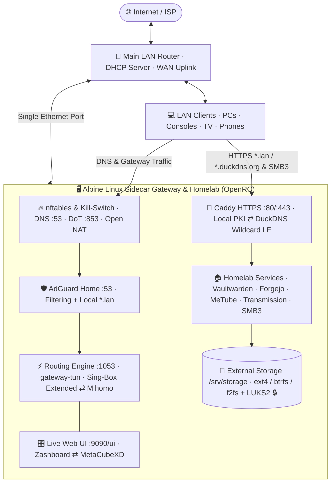

<div align="center">

# 🚀 Universal Sidecar Gateway & Homelab

### Turn any single-NIC mini-PC or SBC into a silent Alpine Linux network gateway, encrypted private cloud, and pure LXC host

<p>
  <a href="README.ru.md"></a>
  <a href="#-quick-start-in-2-minutes"></a>
  <a href="#-legal-disclaimer"></a>
</p>

[](https://github.com/unknownpeace/lol/actions/workflows/ci.yml)
[](https://alpinelinux.org)
[](https://wiki.alpinelinux.org/wiki/OpenRC)
[](https://github.com/shtorm-7/sing-box-extended)
[](https://github.com/MetaCubeX/mihomo)
[](https://github.com/AdguardTeam/AdGuardHome)
[](https://github.com/Zephyruso/zashboard)
[](#-fault-tolerance--luks2-storage)
[](LICENSE)

</div>

> **Documentation revision: November 20, 2026.** Strictly built on **Alpine Linux + OpenRC + `apk`** — zero Docker, zero Snap, zero `opkg` or OpenWrt dependencies. Engineered for compact mini-PCs (**Z83II**, Intel N100/N95), SBCs (**Raspberry Pi**, **Orange Pi**, **NanoPi**), and VMs.

---

## ✨ Why Choose This Project?

Most homelab stacks either consume gigabytes of RAM running nested Docker containers or break cleanly after an unexpected power outage or link flap. **Universal Sidecar Gateway & Homelab** is engineered as a lightweight, self-healing **24/7 network appliance** designed to sit peacefully alongside your existing home router:

| | Highlight | Real-World Benefit |
|---|---|---|
| ⚡ | **~130–200 MB Idle RAM** | Native OpenRC daemons tuned with `cgroups v2` limits and adaptive `GOMEMLIMIT` |
| 🔌 | **Zero-Friction Single-NIC Sidecar** | Plugs into your router via a single Ethernet port with automatic `detect_external_dhcp_server` collision protection |
| 🔄 | **Hot-Swappable Dual-Core & Dual-UI** | Switch live between **Sing-Box Extended ⇄ Mihomo** (auto-verified with instant rollback) and **Zashboard ⇄ MetaCubeXD** (0 core restarts) |
| 🎮 | **Latency-First Gaming QoS** | Game storefronts & P2P stay `DIRECT` with real IP resolution (no FakeIP breaking anti-cheats/NAT), `masquerade persistent` Open NAT, and direct CDN downloads |
| 🔒 | **LUKS2 Storage + Mount Guard** | External USB/SATA/NVMe drives encrypted with `AES-XTS 512-bit + Argon2id`. If detached or locked, the gateway, DNS, and Vaultwarden keep running |
| 🛡️ | **Power-Loss & Link-Flap Recovery** | Boot Guard + Watchdog heal empty/corrupted configs from `.last_good_state`, restore missing default routes, and flush `conntrack` automatically |
| 🏠 | **1-Minute Modular Homelab** | Vaultwarden, Forgejo Git, Samba SMB3 + WSDD + Avahi, MeTube, Transmission, VS Code Web, and switchable HTTPS (`Local PKI ⇄ DuckDNS Let's Encrypt`) |

---

## 🏗️ Network Topology (Single-NIC Sidecar + Homelab)

Your router remains the primary DHCP server (`192.168.1.5`) and instructs LAN devices to use the Alpine Linux gateway as their default gateway and DNS server. The appliance intercepts and secures DNS while routing outbound traffic strictly according to policy groups.



### Single-NIC Routing Hygiene
* **DHCP Collision Guard:** Sidecar mode keeps AdGuard Home DHCP disabled out of the box; enabling it checks for existing router DHCP servers first.
* **Clean Single-Port Forwarding:** Disables ICMP Redirects (`send_redirects=0`, `accept_redirects=0`, `secure_redirects=0`) and `rp_filter=0` on the LAN NIC while enabling `nf_conntrack_tcp_be_liberal=1`, `fq_codel`, and **TCP BBR**.
* **Hardware `gw killswitch`:** Restricts forwarded client WAN traffic strictly to `gateway-tun` while keeping RFC1918/CGNAT local subnets and SSH fully reachable.

---

## 🔄 Dual Core & Dual Web UI Architecture

Choose your preferred engine during setup or hot-swap anytime via CLI or TUI:

| Layer | Option 1 (Default) | Option 2 | Switching Behavior |
|---|---|---|---|
| **Routing Core** | **Sing-Box Extended `v1.14.3`**<br>Native JSON + AWG 2.0 + MASQUE H2 | **Mihomo `v1.19.34`** *(Clash Meta)*<br>Native YAML + `.mrs` rule-providers | `gw core [singbox\|mihomo]`<br>Pre-flight syntax validation & automatic rollback |
| **Web Dashboard** | **Zashboard `v3.30.0`**<br>Fast modern Clash-API dashboard | **MetaCubeXD `v1.275.2`**<br>Classic power-user Meta UI | `gw ui [zashboard\|metacubexd]`<br>Instant UI swap at `:9090/ui` with **0 core restarts** |

> Both engines share a single unified rule definition ([lib/routing_rules.sh](lib/routing_rules.sh)), bring up `gateway-tun` (`MTU 1400`, `system` stack), and support **3 independent upstream slots**:
> 1. **Slot 1:** Remote HTTP/HTTPS subscription endpoints (`custom_sub`).
> 2. **Slot 2:** Local custom URI nodes (`my_nodes.yaml`).
> 3. **Slot 3:** Built-in **Cloudflare WARP / AmneziaWG 2.0 + TCP MASQUE H2** channel (`warp_nodes.json`).

---

## 🎯 Policy-Based Smart Routing & Gaming QoS

Traffic is cleanly segmented across dedicated selectors so low-latency applications stay responsive while cloud APIs, media, and P2P flows are controlled independently:

| Policy Selector | Covered Services & Domains | Default Behavior | Switchable Options in Web UI |
|---|---|---|---|
| **`⚡ Авто (Самый быстрый)`** | Automated `urltest` pool across valid nodes (`tolerance 35ms`) | Lowest measured latency | Auto-selects fastest endpoint |
| **`🤖 Нейросети (ИИ)`** | ChatGPT / OpenAI, Claude, Gemini, AI Studio, Antigravity, Perplexity, xAI/Grok, Cursor, Copilot + isolated `dns_ai` DoH | **`🤖 Авто-ИИ`** | `🇺🇸 США`, `🇩🇪 Германия`, `⚡ Авто`, or any node |
| **`🇩🇪 Германия`** | Dedicated German regional selector (`🇩🇪 Авто-DE`) | **`🇩🇪 Авто-DE`** | Manual per-node selection |
| **`🇺🇸 США`** | Dedicated US regional selector (`🇺🇸 Авто-US`) | **`🇺🇸 Авто-US`** | Manual per-node selection |
| **`🎮 Гейминг`** | Steam, Epic Games, Riot, EA, Ubisoft, Blizzard, PSN, Xbox, Nintendo | **`DIRECT`** | 1-click switch to `🎮 Авто-Гейминг` / `🇩🇪 Германия` |
| **`🧱 Roblox`** | Dedicated policy for Roblox (`roblox.com`, `rbxcdn.com`) | **`🇩🇪 Германия`** | `⚡ Авто`, `🇺🇸 США`, `🎮 Авто-Гейминг`, `DIRECT` |
| **`💬 Мессенджеры`** | Telegram, WhatsApp, Discord (including voice endpoints) | **`⚡ Авто`** | `🇩🇪 Германия`, `🇺🇸 США`, `DIRECT` |
| **`▶️ YouTube & Медиа`** | YouTube, **Twitch** (`twitch.tv`, `ttvnw.net`), **Spotify** (`spotify.com`, `scdn.co`) | **`⚡ Авто`** | `🇩🇪 Германия`, `🇺🇸 США`, `DIRECT` |
| **`🧲 Торренты`** | BitTorrent protocol, tracker lists (`torrent_domain`), ports `6881–6889` / `51413` | **`DIRECT`** | 1-click switch to `🇩🇪 Германия`, `🇺🇸 США`, `⚡ Авто`, or any node |
| **`🌐 Google & Android`** | Standard Google services & OS updates (matched after AI rules) | **`DIRECT`** | `⚡ Авто`, `🇩🇪 Германия`, `🇺🇸 США` |
| **`🌐 Остальной трафик`** | Default fallback routing policy | **`DIRECT`** | Any group or endpoint |

### DNS Hygiene & Domain Inspection
* **Dual-Stage DNS:** **AdGuard Home** (`:53`, `ratelimit: 0`, automated `*.lan` rewrites) forwards external lookups to the active core (`127.0.0.1:1053`), combining **FakeIP (`198.18.0.0/15`)**, `.lan` static hosts, and split **DoH** resolvers (`dns_ai`, `dns_proxy`, `dns_ru`, `dns_bootstrap`).
* **Real IPs for Gaming:** Game launchers and matchmaking servers resolve natively without FakeIP interference, and bulky patch CDNs (`steamcontent.com`, `akamaized.net`) stay `DIRECT` even when a gaming group is routed elsewhere.
* **Instant CLI Domain Rules:** `gw domain direct <url|domain>`, `gw domain proxy <url|domain>`, and live DNS + TLS tracing via `gw domain test <domain>`.

---

## 🏠 Modular Homelab Suite & Switchable HTTPS

Every Homelab service binds exclusively to `127.0.0.1` and is reverse-proxied over TLS by **Caddy**. Switch seamlessly anytime between a zero-dependency **Local PKI CA (`http://ca.lan`)** and **DuckDNS Let's Encrypt Wildcard** certificates (with automatic reuse of valid cached certificates):

| # | Module | Purpose | Local Address | DuckDNS HTTPS | Backend Port |
|---|---|---|---|---|---|
| **`1`** | **Caddy & Local PKI** | Reverse Proxy + one-click Root CA portal for Windows/Linux/Android | `http://ca.lan` · `https://panel.lan` | `https://zashboard.<sub>.duckdns.org` | `:80` / `:443` |
| **`2`** | **Samba SMB3 + WSDD + Avahi** | Network share discoverable natively in Windows 11 & Linux/macOS | `\\homelab\storage` | — *(LAN only)* | `:445` |
| **`3`** | **Vaultwarden** | Self-hosted Bitwarden-compatible password manager | `https://vaultwarden.lan` | `https://vaultwarden.<sub>.duckdns.org` | `127.0.0.1:8222` |
| **`4`** | **Forgejo** | Lightweight self-hosted Git forge with web UI & issue tracking | `https://forgejo.lan` | `https://forgejo.<sub>.duckdns.org` | `127.0.0.1:3001` |
| **`5`** | **VS Code Server** | Full browser IDE for remote configuration and coding | `https://code.lan` | `https://code.<sub>.duckdns.org` | `127.0.0.1:8443` |
| **`6`** | **MeTube (`yt-dlp`)** | Web downloader saving directly into `Videos` & `Music` folders | `https://downloads.lan` | `https://downloads.<sub>.duckdns.org` | `127.0.0.1:8081` |
| **`7`** | **Transmission** | Background BitTorrent daemon with BasicAuth-protected Web UI | `https://torrents.lan` | `https://torrents.<sub>.duckdns.org` | `127.0.0.1:9091` |

> **Unified Password Rotation:** `gw passwd <new_password>` updates Clash API (`:9090`), AdGuard Home (`:3000`), Samba (`homelab`), Vaultwarden `/admin`, Transmission RPC, and Caddy BasicAuth in a single synchronized step.

---

## 🛡️ Fault Tolerance & LUKS2 Storage

Engineered for unattended operation even on hardware without a UPS:

* **LUKS2 Drive Manager (`gw disk`):** Partition & format external drives to `ext4`, `btrfs` (`zstd:3` subvolumes), or `f2fs` inside a **LUKS2 (`AES-XTS 512-bit + Argon2id`)** container with OS-disk protection, native OpenRC `dmcrypt` integration, `0400` keyfile auto-unlock, and safe park/unmount commands (`gw lock` / `gw unlock` / `gw safe-poweroff`).
* **Boot Guard (`/etc/local.d/50-gateway-boot-guard.start`):** On boot after an unclean power cut, clears stale lock dirs, restores zeroed/damaged configs from persistent `.last_good_state`, unlocks & remounts LUKS2 storage, and starts all enabled services.
* **Mount Guard (Root-FS Overflow Protection):** If the encrypted drive is missing or locked, **the gateway core, AdGuard Home, Caddy, and Vaultwarden stay online**, while storage-heavy daemons (`samba`, `wsdd`, `forgejo`, `metube`, `transmission`) remain safely paused until `gw unlock`.
* **Watchdog & Network Self-Healing (`gw doctor`):** Restores missing `default via <router>` routes after Ethernet link flaps, flushes stale `conntrack` tables, reloads stalled providers, and monitors `wsdd`.
* **Consistent Backups (`gw backup create / restore`):** Creates `0600` archives bundling live SQLite `.backup` snapshots (Vaultwarden & Forgejo), configs, keys, and ACME certificates — saved locally, on external storage, and optionally pushed to Telegram (`gw backup telegram`).

---

## 📦 Pure LXC Virtualization

Manage lightweight system containers (Alpine, Debian, Ubuntu, Arch, etc.) with `gw lxc` using native Linux primitives — no Docker daemon overhead:
* Supports `lxcbr0` (NAT) and direct LAN `macvlan` networking.
* Instant container snapshots & rollbacks (`gw lxc snap`).
* Built-in network auto-repair (`gw lxc doctor` / `gw lxc fix-net`).

---

## ⚡ Quick Start in 2 Minutes

SSH into your fresh **Alpine Linux** system as `root`:

### Option 1: Interactive Installer (Recommended)
```sh
apk add --no-cache git
git clone https://github.com/unknownpeace/lol.git /opt/gateway
cd /opt/gateway
./setup.sh
```

### Option 2: Zero-Touch Unattended Deployment
```sh
# Generate an annotated answers template
gw answers template /root/gateway.answers

# Validate the file and deploy everything non-interactively
gw answers verify /root/gateway.answers
gw install --answers /root/gateway.answers
```

Launch the management dashboard anytime via **`gw`** (or **`gateway`**):

```text
╔══════════════════════════════════════════════════════════════════════════════╗
║  🚀 UNIVERSAL SIDECAR GATEWAY & HOMELAB // ALPINE LINUX
╠══════════════════════════════════════════════════════════════════════════════╣
║  • Host / OS:    homelab (x86_64)         │ Uptime: 4d 12h     │ Load: 0.14 0.18 0.12
║  • Network:      LAN: 192.168.1.10 (eth0) │ Router: 192.168.1.5
║  • Memory (RAM): 168 MB / 1940 MB (8%)
║  • Storage:      /srv/storage: 12G / 465G (3%) [ext4 / LUKS2 🔒]
║  • Gateway Core: Sing-Box Extended [●] │ AdGuard Home (:53) [●] │ gateway-tun [●] │ UI: Zashboard
║  • Homelab:      caddy[●] samba[●] vaultwarden[●] forgejo[●] ytdlp[●] torrent[●]
║  • SSL / Domain: Let's Encrypt Wildcard (*.example.duckdns.org)
║  • Updates:      v2026.11 (Git) [up to date ●]
╚══════════════════════════════════════════════════════════════════════════════╝
```

---

## 🛠️ Essential CLI Reference

<details>
<summary><b>Click to expand the complete <code>gw</code> CLI & TUI command reference</b></summary>

```sh
# Diagnostics & Lifecycle
gw                                # Open interactive TUI telemetry dashboard
gw status                         # Self-Test 2.0: service health, groups, DNS checks & latency matrix
gw check                          # Non-invasive config, SSL, memory & conntrack audit
gw doctor                         # Full automated network, kernel module, nftables, DB & storage repair
gw motd                           # Print compact system status banner
gw links                          # Display all HTTPS URLs and Samba network share paths
gw logs [core|caddy|adguard|...]  # View service logs (e.g., gw logs core 100)
gw restart                        # Rebuild config safely, flush conntrack & restart core + DNS
gw update [check]                 # Atomic 5-stage Git + core binary updater

# Engines, Dashboards & Security
gw core [singbox|mihomo|status]   # Hot-switch active engine with validation & auto-rollback
gw ui [zashboard|metacubexd]      # Switch Clash-API dashboard without restarting the core
gw killswitch [on|off|status]     # Toggle hardware nftables Kill-Switch (forward strictly via TUN)
gw ssl [status|local|renew]       # Manage HTTPS certificates (Local PKI or DuckDNS Let's Encrypt)
gw ssl duckdns <sub> <token>       # Issue or smart-reuse Wildcard Let's Encrypt certificate
gw passwd [new_password]          # Synchronize master password across all gateway & Homelab apps

# Policy Routing & Upstreams
gw proxy                          # Interactive SSH node & group switcher
gw proxy add <url|uri|warp>       # Add HTTP subscription (Slot 1), URI node (Slot 2), or WARP (Slot 3)
gw domain direct <url|domain>     # Route domain directly via WAN (DIRECT)
gw domain proxy <url|domain>      # Route domain via user custom proxy list
gw domain test <domain>           # Trace DNS resolution (:53) and live TLS handshake time

# LUKS2 Storage, Backups & Safe Power Control
gw disk                           # Partition, format & LUKS2-encrypt external storage
gw unlock / gw lock               # Unlock LUKS2 volume or cleanly stop services & close container
gw backup [create|full|restore]   # Atomic backup & restore (configs + SQLite dumps + certificates)
gw safe-reboot / gw safe-poweroff # Cleanly park DBs, sync disks, close LUKS2 & reboot/halt

# LXC Containers & Unattended Answers
gw lxc [list|create|start|stop]   # Native Linux container management
gw lxc snap <name> [create|restore]# Container snapshot & rollback
gw answers [template|verify]      # Generate or validate unattended install answers
```

</details>

---

## 💻 Requirements & Further Docs

| Component | Minimum | Recommended (Full Gateway + Homelab) |
|---|---|---|
| **OS** | **Alpine Linux 3.21 – 3.24+** (`x86_64` / `aarch64`) | Alpine Linux 3.24+ (Standard / Extended) |
| **CPU** | 1–2 cores (`x86_64` or ARM64) | Intel Atom Z8350 (Z83II), Intel N100/N95, ARMv8 |
| **Memory** | 512 MB RAM *(Gateway + DNS)* | 1.5–4 GB RAM *(Gateway + all Homelab modules + LXC)* |
| **Disk** | 2 GB free rootfs | 16 GB+ eMMC/SSD + dedicated external drive for LUKS2 |

* 📘 Architecture overview and module contracts: [ARCHITECTURE.md](ARCHITECTURE.md).
* 🤖 Contributor and automation conventions: [AGENTS.md](AGENTS.md).

---

## ⚖️ Legal Disclaimer

> This repository provides an **open-source automation suite for local network administration, DNS hygiene, policy-based traffic routing, LUKS2 disk encryption, and self-hosted Homelab orchestration** on Alpine Linux.
>
> * This project **does not** bundle, distribute, or endorse any third-party servers, proxy credentials, subscription links, or instructions intended to evade applicable legal or regulatory restrictions.
> * Operators are solely responsible for configuring their own endpoints, rules, and self-hosted services and for ensuring full compliance with all applicable local and international laws.

---

<div align="center">

**Universal Sidecar Gateway & Homelab** is open-source software licensed under the [MIT License](LICENSE).

</div>
