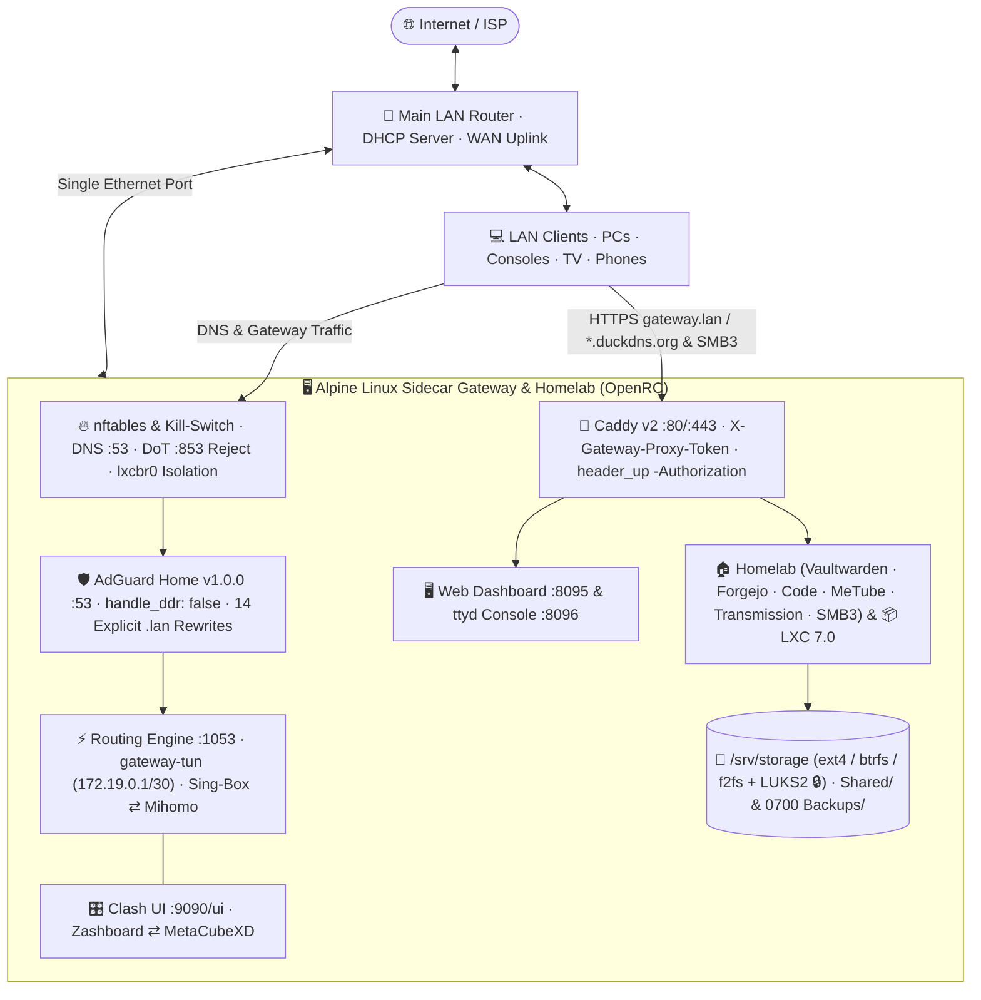

<div align="center">

# 🚀 Universal Sidecar Gateway & Homelab

### Turn any single-NIC mini-PC, SBC, or OpenWrt 25.12.6+ router into a high-efficiency network gateway, ad-filtering DNS appliance, and (on Alpine Linux) encrypted Homelab with LXC 7.0 Studio

<p>
  <a href="README.ru.md"></a>
  <a href="#-quick-start-in-2-minutes"></a>
  <a href="#-beginner-troubleshooting-faq"></a>
  <a href="#-legal-disclaimer"></a>
</p>

[](https://github.com/unknownpeace/lol/actions/workflows/ci.yml)
[](https://alpinelinux.org)
[-00B5E2?logo=openwrt&logoColor=white)](https://openwrt.org)
[-2ea043)](https://wiki.alpinelinux.org/wiki/OpenRC)
[](https://github.com/shtorm-7/sing-box-extended)
[](https://github.com/MetaCubeX/mihomo)
[](https://github.com/AdguardTeam/AdGuardHome)
[](#-web-dashboard-lxc-70-studio--openwrt-luci)
[](#-fault-tolerance--luks2-storage)
[](LICENSE)

</div>

> **Release `v2026.11.2` (November 22, 2026).** Native **`apk`-only** architecture across **Alpine Linux 3.23–3.24+ (OpenRC + cgroups v2)** and **OpenWrt >= 25.12.6 (`procd` + `fw4` + native LuCI SPA)** — zero Docker daemon, zero Snap, zero legacy `opkg`. Engineered for mini-PCs (**Z83II**, Intel N100/N95), SBCs (**Raspberry Pi**, **Orange Pi**, **NanoPi**), x86/ARM64 OpenWrt routers, and VMs.

---

## 🎯 Two Focused Platform Profiles

| Capability | Alpine Linux (`3.23 – 3.24+`, OpenRC) | OpenWrt (`>= 25.12.6`, `procd` + `fw4` + `apk`) |
|---|---|---|
| **Routing Gateway** (`Sing-Box Extended ⇄ Mihomo`, `Zashboard ⇄ MetaCubeXD`, WARP 2.0) | ✅ Full | ✅ Full |
| **DNS & Ad Filtering** (`AdGuard Home v1.0.0` `:53`/`:3000`, `handle_ddr: false`, explicit `.lan` rewrites) | ✅ Full (14 managed `.lan` hostnames) | ✅ Full (6 hostnames; `dnsmasq` yields `:53`; **LuCI `:80` preserved**) |
| **Management Interface** | ✅ **Alpine Web Dashboard (`:8095`)** + **`ttyd` Console (`:8096`)** + `gw` TUI/CLI | ✅ **Native LuCI SPA (`admin/gateway`)** + `gw` TUI/CLI |
| **Network Hardening** (`Kill-Switch`, `Doctor`, `Watchdog`, `SelfTest`, `gw passwd`, `gw backup`) | ✅ Native `nftables` + `lxcbr0` isolation | ✅ Native `fw4` (`/etc/nftables.d/90-gateway.nft`) + LAN IP-conflict guard |
| **Homelab, Caddy PKI/SSL, LUKS2 Storage & LXC 7.0 Studio** | ✅ Full | ⛔ Excluded by design (keeps router fast & minimal) |
| **Legacy `< 25.12.6` / `opkg` builds** | — | ❌ Rejected cleanly during OS detection |

---

## ✨ Why Choose This Project?

Most homelab stacks either consume gigabytes of RAM running nested Docker containers or break after an unexpected power cut or link flap. **Universal Sidecar Gateway & Homelab** is engineered as a lightweight, self-healing **24/7 network appliance** designed to sit peacefully alongside your existing home router:

| | Highlight | Real-World Benefit |
|---|---|---|
| ⚡ | **Low-RAM Native Daemons** | `~130–200 MB` idle RAM for Gateway + DNS (`~220–320 MB` with Alpine Web Dashboard & Caddy) with adaptive `GOMEMLIMIT` tiers down to 256 MB OpenWrt routers |
| 🖥️ | **Zero-Build Web Dashboard & LuCI SPA** | Modern **Obsidian Glass / Porcelain Slate** Web UI (`:8095`) with `<250ms` fast telemetry, `Ctrl+K` Command Palette, mobile bottom nav, and native **OpenWrt LuCI** integration |
| 🔄 | **Hot-Swappable Dual-Core & Dual-UI** | Switch live between **Sing-Box Extended ⇄ Mihomo** (pre-flight validation + auto-rollback) and **Zashboard ⇄ MetaCubeXD** (0 core restarts) |
| 📦 | **LXC 7.0 Container Studio + `ttyd` Console** | Provision Alpine/Debian/Ubuntu/Arch containers via a 3-step wizard, manage snapshots/clones/CPU/RAM, and open tokenized root web terminals (`:8096`) right in your browser |
| 🎮 | **Latency-First Gaming QoS** | Game storefronts & P2P stay `DIRECT` with real IPs (no FakeIP breaking anti-cheats/NAT), `masquerade persistent` Open NAT, and direct CDN downloads |
| 🔒 | **Defense-in-Depth & LUKS2 Hardening** | `X-Gateway-Proxy-Token` + `header_up -Authorization`, `/run/gateway` (`0700`) isolation, `/srv/storage/Shared` scoping, `0700` `Backups/` without LUKS keys, and RAM-aware Argon2id encryption |
| 🛡️ | **Power-Loss & Link-Flap Recovery** | Boot Guard + OpenRC Mount Guard + Watchdog recover damaged configs from `.last_good_state`, keep DNS/Vaultwarden alive if USB disks detach, and heal routes/`conntrack` automatically |

---

## 🖥️ Web Dashboard, LXC 7.0 Studio & OpenWrt LuCI

### Alpine Linux Web Dashboard (`https://gateway.lan` · `:8095`) & `ttyd` Console (`:8096`)
A zero-dependency, zero-build web control plane (`modules/webui/server.py` + vanilla HTML/CSS/JS):
- **Fast Native Telemetry Engine:** Collects system, OpenRC, storage, Clash API, AdGuard Home, and LXC state natively in Python 3 stdlib (`<250 ms` warm `/api/status` responses).
- **Obsidian Glass (Dark) & Porcelain Slate (Light):** Single-row sticky desktop header, **`Ctrl+K` / `/` Command Palette**, collapsible **First-Run Onboarding**, `?` contextual tooltips, 4-node interactive Traffic Pipeline, 240° radial gauges & sparklines, and **mobile thumb-zone bottom navigation** (`<=640px`, 0px horizontal overflow).
- **Proxies, Domain X-Ray & Live Logs:** Edit Slot 1→2→3 upstreams, test DNS + live TLS latency per domain, toggle Kill-Switch/DHCP/Cron switches, inspect severity-tinted service logs, and manage SSL / LUKS2 storage in one click.
- **LXC 7.0 Container Studio:** 3-step container wizard (live catalog from `images.linuxcontainers.org` + offline fallback), `lxcbr0` NAT or direct LAN `macvlan`, live CPU/RAM limits, snapshots & rollbacks, cloning with fresh MACs, Quick Exec, and an embedded **browser `ttyd` root terminal** (`127.0.0.1:8096`) authenticated by single-use 60-second tokens in `/run/gateway/console_tokens`.
- **Hardened Authentication:** Behind Caddy (`AUTH_MODE="caddy"`), enforces bcrypt `basic_auth` + `header_up -Authorization` + constant-time `X-Gateway-Proxy-Token`. Without Caddy (`AUTH_MODE="basic"`), enforces BasicAuth with per-IP brute-force exponential backoff (`HTTP 429`).

### OpenWrt Native LuCI SPA (`luci-app-gateway`)
On **OpenWrt >= 25.12.6**, `./setup.sh` automatically registers a native **Sidecar Gateway** menu (`admin/gateway`) directly inside LuCI (`uhttpd :80`) with 5 tabs:
1. **Overview** — real-time core, TUN, AdGuard Home, DHCP leases, and memory telemetry.
2. **Core & Network** — hot-swap Sing-Box ⇄ Mihomo & Zashboard ⇄ MetaCubeXD, Kill-Switch, DHCP, static IP/GW.
3. **Proxies & Routes** — multi-line subscription editor, custom URI nodes, WARP 2.0, domain/device rules, Domain X-Ray.
4. **Telegram & Backup** — Telegram alerts, unified backup/restore, and password rotation.
5. **Update & Logs** — Git/binary updates and live log streaming via async `rpcd`/`ubus` jobs (`job_start`/`job_poll`).

---

## 🏗️ Network Topology (Single-NIC Sidecar + Homelab)

Your router remains the primary DHCP server (`192.168.1.5`) and instructs LAN devices to use the gateway as their default gateway and DNS server.



### Single-NIC Routing Hygiene
* **DHCP Collision Guard:** Sidecar mode keeps AdGuard Home DHCP disabled by default; enabling it probes for existing router DHCP servers (`detect_external_dhcp_server`) and checks IP conflicts (`check_ip_conflict_on_lan`).
* **Clean Single-Port Forwarding:** Disables ICMP Redirects (`send_redirects=0`, `accept_redirects=0`, `secure_redirects=0`) and `rp_filter=0` on the LAN NIC while enabling `nf_conntrack_tcp_be_liberal=1`, `fq_codel`, and **TCP BBR**.
* **Hardware `gw killswitch`:** Restricts forwarded WAN traffic from both `${LAN_IF}` and `lxcbr0` strictly to `gateway-tun`, while keeping RFC1918 local subnets and SSH reachable.

---

## 🔄 Dual Core & Dual Clash-API UI Architecture

Choose your preferred engine during setup or hot-swap anytime via Web Dashboard, LuCI, CLI, or TUI:

| Layer | Option 1 (Default) | Option 2 | Switching Behavior |
|---|---|---|---|
| **Routing Core** | **Sing-Box Extended `v1.14.3-extended-2.7.3`**<br>Native JSON + AWG 2.0 + MASQUE H2 + `.srs` | **Mihomo `v1.19.34`** *(Clash Meta)*<br>Native YAML + AWG + `.mrs` rule-providers | `gw core [singbox\|mihomo]`<br>Pre-flight syntax validation & automatic rollback |
| **Clash Web UI** | **Zashboard `v3.30.0`**<br>Fast modern Clash-API dashboard | **MetaCubeXD `v1.275.2`**<br>Classic power-user Meta UI | `gw ui [zashboard\|metacubexd]`<br>Instant UI swap at `:9090/ui` with **0 core restarts** |

> Both engines share a single unified rule definition ([lib/routing_rules.sh](lib/routing_rules.sh)), configure `gateway-tun` (`172.19.0.1/30`, `MTU 1400`, `stack: system`, `auto_redirect: true`), verify release downloads via fail-closed SHA-256 checks, and support **3 independent upstream slots**:
> 1. **Slot 1:** Remote HTTP/HTTPS subscriptions (`custom_sub`).
> 2. **Slot 2:** Local custom URI nodes (`my_nodes.yaml`).
> 3. **Slot 3:** Built-in **Cloudflare WARP 2.0 / AmneziaWG + TCP MASQUE H2** (`warp_nodes.json`).

---

## 🎯 Policy-Based Smart Routing & Gaming QoS

| Policy Selector | Covered Services & Domains | Default Behavior | Switchable Options in Web UI |
|---|---|---|---|
| **`⚡ Авто (Самый быстрый)`** | Automated `urltest` pool across valid nodes (`tolerance 35ms`, fail-closed stub) | Lowest measured latency | Auto-selects fastest endpoint |
| **`🤖 Нейросети (ИИ)`** | ChatGPT / OpenAI, Claude, Gemini, AI Studio, Antigravity, Perplexity, xAI/Grok, Cursor, Copilot + isolated `dns_ai` DoH | **`🤖 Авто-ИИ`** | `🇺🇸 США`, `🇩🇪 Германия`, `⚡ Авто`, or any node |
| **`🇩🇪 Германия`** | Dedicated German regional selector (`🇩🇪 Авто-DE`) | **`🇩🇪 Авто-DE`** | Manual per-node selection |
| **`🇺🇸 США`** | Dedicated US regional selector (`🇺🇸 Авто-US`) | **`🇺🇸 Авто-US`** | Manual per-node selection |
| **`🎮 Гейминг`** | Steam, Epic Games, Riot, EA, Ubisoft, Blizzard, PSN, Xbox, Nintendo | **`DIRECT`** | 1-click switch to `🎮 Авто-Гейминг` / `🇩🇪 Германия` |
| **`🧱 Roblox`** | Dedicated policy for Roblox (`roblox.com`, `rbxcdn.com`) | **`🇩🇪 Германия`** | `⚡ Авто`, `🇺🇸 США`, `🎮 Авто-Гейминг`, `DIRECT` |
| **`💬 Мессенджеры`** | Telegram, WhatsApp, Discord (including voice endpoints) | **`⚡ Авто`** | `🇩🇪 Германия`, `🇺🇸 США`, `DIRECT` |
| **`▶️ YouTube & Медиа`** | YouTube, **Twitch** (`twitch.tv`, `ttvnw.net`), **Spotify** (`spotify.com`, `scdn.co`) | **`⚡ Авто`** | `🇩🇪 Германия`, `🇺🇸 США`, `DIRECT` |
| **`🧲 Торренты`** | BitTorrent protocol, tracker lists (`torrent_domain`), ports `6881–6889` / `51413` | **`DIRECT`** | 1-click switch to `🇩🇪 Германия`, `🇺🇸 США`, `⚡ Авто`, or any node |
| **`🌐 Google & Android`** | Standard Google services & OS updates (matched after AI rules) | **`DIRECT`** | `⚡ Авто`, `🇩🇪 Германия`, `🇺🇸 США` |
| **`📺 Устройства (Full-VPN)`** | Dynamic policy for IPs listed in `force_proxy_devices.conf` (highest priority, incl. DNS & QUIC) | Active proxy pool | Created automatically when Full-VPN devices are added |
| **`🌐 Остальной трафик`** | Default fallback routing policy | **`DIRECT`** | Any group or endpoint |

### DNS Hygiene & Domain Inspection
* **Dual-Stage DNS:** **AdGuard Home v1.0.0** (`:53`, `ratelimit: 0`, **`handle_ddr: false`**, 14 explicit managed `.lan` rewrites on Alpine / 6 on OpenWrt) forwards lookups to the active core (`127.0.0.1:1053`), combining **FakeIP (`198.18.0.0/15`)**, `dns_homelab` (`A`-scoped), and split **DoH** (`dns_ai`, `dns_proxy`, `dns_ru`, `dns_bootstrap`).
* **Real IPs for Gaming:** Game launchers and matchmaking servers resolve natively via `dns_ru` without FakeIP interference, and bulky patch CDNs (`steamcontent.com`, `akamaized.net`) stay `DIRECT`.
* **Instant Domain Rules & X-Ray:** `gw domain direct <domain>`, `gw domain proxy <domain>`, and live DNS + TLS tracing via `gw domain test <domain>` (or **Domain X-Ray** in the Web Dashboard / LuCI).

---

## 🏠 Modular Homelab Suite & Switchable HTTPS (Alpine Linux)

Every Homelab backend binds exclusively to `127.0.0.1` and is published over HTTPS by **Caddy v2** (`Local PKI http://ca.lan` ⇄ `DuckDNS Let's Encrypt EC-256 Wildcard` with smart certificate reuse):

| # | Module | Purpose | Local Address | DuckDNS HTTPS | Backend |
|---|---|---|---|---|---|
| **`0`** | **Web Dashboard & `ttyd`** | Native control panel + tokenized LXC web console | `https://gateway.lan` *(or `:8095`)* | `https://gateway.<sub>.duckdns.org` | `127.0.0.1:8095` / `:8096` |
| **`1`** | **Caddy v2 & Local PKI** | Reverse Proxy + Obsidian Glass Root CA portal (`ca.lan`) | `http://ca.lan` · `https://panel.lan` | `https://zashboard.<sub>.duckdns.org` | `:80` / `:443` |
| **`2`** | **Samba SMB3 + WSDD + Avahi** | Network shares (`[storage]` -> `/srv/storage/Shared`, `[Music]`, `[Videos]`, `[Downloads]`) | `\\<host>\storage` | — *(LAN RFC1918 only)* | `:445` |
| **`3`** | **Vaultwarden** | Self-hosted Bitwarden password manager (Argon2id `/admin`, signups off) | `https://vaultwarden.lan` | `https://vaultwarden.<sub>.duckdns.org` | `127.0.0.1:8222` |
| **`4`** | **Forgejo** | Lightweight self-hosted Git forge (public registration disabled) | `https://forgejo.lan` | `https://forgejo.<sub>.duckdns.org` | `127.0.0.1:3001` |
| **`5`** | **VS Code Web (`code serve-web`)** | Official Microsoft browser IDE behind Caddy BasicAuth | `https://code.lan` | `https://code.<sub>.duckdns.org` | `127.0.0.1:8443` |
| **`6`** | **MeTube (`yt-dlp`)** | Video/audio downloader (`crane`-unpacked native Python daemon, zero Docker runtime) | `https://downloads.lan` | `https://downloads.<sub>.duckdns.org` | `127.0.0.1:8081` |
| **`7`** | **Transmission** | Background BitTorrent daemon with Caddy BasicAuth Web UI | `https://torrents.lan` | `https://torrents.<sub>.duckdns.org` | `127.0.0.1:9091` |

> **Unified Password Rotation (`gw passwd <new_password>`):**
> - **Alpine Linux:** Synchronously updates Clash API (`:9090`), AdGuard Home (`:3000`), Web Dashboard (`:8095`), Samba (`homelab`), Vaultwarden `/admin`, Transmission RPC, and Caddy BasicAuth.
> - **OpenWrt:** Synchronously updates Clash API (`:9090`) and AdGuard Home (`:3000`).

---

## 🛡️ Fault Tolerance, LUKS2 Storage & Pure LXC 7.0

Engineered for unattended operation even without a UPS:

* **LUKS2 Drive Manager (`gw disk`):** Provision external USB/SATA/NVMe drives with `ext4`, `btrfs` (`compress=zstd:3` with automatic SSD/HDD detection), or `f2fs` inside **LUKS2 (`AES-XTS 512-bit + Argon2id`)** with RAM-aware `--pbkdf-memory` (prevents OOM on 512 MB SBCs), OS-disk protection, OpenRC `dmcrypt` + `0400` keyfile auto-unlock, and clean unmount/close (`gw lock` / `gw unlock` / `gw safe-poweroff` — stops running LXC containers and avoids unsafe lazy unmounts).
* **OpenRC Mount Guard (`/usr/lib/gateway/storage-mount-guard.sh`) & Boot Guard:** On boot after an unclean power cut, Boot Guard restores damaged configs from `.last_good_state`, unlocks LUKS2 storage, and starts enabled services. If the external drive is detached or locked, **the gateway core, AdGuard Home, Caddy, Web Dashboard, and Vaultwarden stay online**, while storage-heavy daemons (`samba`, `forgejo`, `code-server`, `metube`, `transmission-daemon`) stay safely paused via `start_pre()` until `gw unlock`.
* **Scoped Storage & Confidential Backups (`gw backup`):** Samba `[storage]` and LXC bind-mounts access **`/srv/storage/Shared`** exclusively. `/srv/storage/Backups` is isolated at **`0700 root:root`** (`0600` archives), and `gw backup create` bundles live SQLite `.backup` dumps, configs, and ACME certs while **explicitly excluding `*storage.luks.key*`** (optional push via `gw backup telegram`).
* **Pure LXC 7.0 Virtualization (`gw lxc` & Web LXC Studio):** Native Linux containers (cgroups v2 `lxc.cgroup2.*`, upstream `nesting.conf`), firewall-isolated `lxcbr0` NAT or direct LAN `macvlan`, instant snapshots (`gw lxc snap`), cloning, Quick Exec, browser `ttyd` console, and network auto-repair (`gw lxc doctor` / `gw lxc fix-net`).

---

## ⚡ Quick Start in 2 Minutes

SSH into your **Alpine Linux (`3.23–3.24+`)** or **OpenWrt (`>= 25.12.6` with `apk`)** host as `root`:

### Option 1: Interactive Installer (Recommended)
```sh
# 1. Install git
# Alpine Linux:
apk add --no-cache git
# OpenWrt >= 25.12.6:
apk update && apk add git git-http

# 2. Clone repository & launch installer
# (Alpine: full suite + Web Dashboard :8095; OpenWrt: Gateway + AdGuard Home + LuCI SPA)
git clone https://github.com/unknownpeace/lol.git /opt/gateway
cd /opt/gateway
./setup.sh
```

### Option 2: Zero-Touch Unattended Deployment
First clone the repository (because `gw` is registered when `./setup.sh` runs), prepare your answers file, validate it, and deploy non-interactively:

```sh
# 1. Clone repository (install git as shown in Option 1 first)
git clone https://github.com/unknownpeace/lol.git /opt/gateway
cd /opt/gateway

# 2. Create & customize your answers file (sections 3-5 are automatically skipped on OpenWrt)
cp gateway.answers.example /root/gateway.answers
vi /root/gateway.answers

# 3. Validate syntax and deploy non-interactively
./setup.sh answers verify /root/gateway.answers
./setup.sh --answers /root/gateway.answers
```

*(Once `./setup.sh` has run, `/usr/bin/gw` and `/usr/bin/gateway` are installed globally so you can run `gw answers template`, `gw answers verify`, or `gw` directly from anywhere.)*

```text
╔══════════════════════════════════════════════════════════════════════════════╗
║  🚀 UNIVERSAL SIDECAR GATEWAY & HOMELAB // ALPINE LINUX
╠══════════════════════════════════════════════════════════════════════════════╣
║  • Host / OS:    gateway (x86_64)         │ Uptime: 4d 12h     │ Load: 0.14 0.18 0.12
║  • Network:      LAN: 192.168.1.10 (eth0) │ Router: 192.168.1.5
║  • Memory (RAM): 245 MB / 1940 MB (12%)
║  • Storage:      /srv/storage: 12G / 465G (3%) [ext4 / LUKS2 🔒]
║  • Gateway Core: Sing-Box Extended [●] │ AdGuard Home (:53) [●] │ gateway-tun [●] │ UI: Zashboard
║  • Dashboard:    https://gateway.lan (:8095) [●] │ Console ttyd (:8096) [●]
║  • Homelab:      caddy[●] samba[●] vaultwarden[●] forgejo[●] ytdlp[●] torrent[●]
║  • SSL / Domain: Let's Encrypt Wildcard (*.example.duckdns.org)
║  • Updates:      v2026.11.2 (Git) [up to date ●]
╚══════════════════════════════════════════════════════════════════════════════╝
```

---

## 🛠️ Essential CLI Reference

<details>
<summary><b>Click to expand the complete <code>gw</code> CLI & TUI command reference</b></summary>

```sh
# Diagnostics & Lifecycle
gw                                # Open interactive TUI telemetry dashboard
gw status                         # Self-Test 2.0: service health, groups, DNS checks & latency matrix
gw check                          # Non-invasive config, SSL, memory & conntrack audit
gw doctor                         # Full automated network, kernel module, nftables, DB & storage repair
gw motd                           # Print compact system status banner
gw links                          # Display all HTTPS URLs, Web Dashboard, LuCI & Samba paths
gw logs [core|adguard|caddy|webui|console|...]  # View service logs (e.g., gw logs webui 100)
gw restart                        # Rebuild config safely, flush conntrack & restart core + DNS
gw update [check]                 # Atomic 5-stage Git + SHA-256 verified core binary updater

# Engines, Dashboards & Security
gw core [singbox|mihomo|status]   # Hot-switch active engine with validation & auto-rollback
gw ui [zashboard|metacubexd]      # Switch Clash-API dashboard without restarting the core
gw killswitch [on|off|status]     # Toggle hardware nftables/fw4 Kill-Switch (forward strictly via TUN)
gw ssl [status|local|renew]       # Manage HTTPS certificates (Local PKI or DuckDNS EC-256 Let's Encrypt)
gw ssl duckdns <sub> <token>       # Issue or smart-reuse Wildcard Let's Encrypt certificate
gw passwd [new_password]          # Synchronize master password across gateway, WebUI & Homelab apps

# Policy Routing & Upstreams
gw proxy [add <url|uri|warp>|list]# Manage Slot 1 subscriptions, Slot 2 URI nodes, or Slot 3 WARP 2.0
gw domain direct <url|domain>     # Route domain directly via WAN (DIRECT)
gw domain proxy <url|domain>      # Route domain via user custom proxy list
gw domain test <domain>           # Trace DNS resolution (:53) and live TLS handshake time

# LUKS2 Storage, Backups & Safe Power Control (Alpine)
gw disk                           # Partition, format & LUKS2-encrypt external storage
gw unlock / gw lock               # Unlock LUKS2 volume or cleanly stop services/LXC & close container
gw backup [create|full|restore]   # Atomic 0600 backup & restore (excludes storage.luks.key)
gw safe-reboot / gw safe-poweroff # Cleanly park DBs/LXC, sync disks, close LUKS2 & reboot/halt

# LXC 7.0 Containers & Unattended Answers (Alpine)
gw lxc [list|create|start|stop|restart|attach]  # Native Linux container lifecycle
gw lxc snap <name> [create|list|restore|delete] # Container snapshots & rollbacks
gw lxc autostart <name> [on|off]                # Toggle container boot autostart
gw lxc [doctor|fix-net <name>|menu]             # Repair LXC bridge/DNS or open LXC TUI menu
gw answers [template|verify]                    # Generate or validate unattended install answers
```

</details>

---

## ❓ Beginner Troubleshooting FAQ

<details>
<summary><b>1. A website or app won't open / loads slowly</b></summary>

1. Run **Domain X-Ray** (`gw domain test example.com` or **Web Dashboard → Proxies → Domain X-Ray**): check which DNS IP (`FakeIP 198.18.x.x` vs real IP) and routing policy matched.
2. Force a single site direct or proxied on the fly:
   - `gw domain proxy example.com` (route via proxy pool)
   - `gw domain direct example.com` (bypass tunnel via WAN)
3. Check if your browser has **DNS-over-HTTPS (Secure DNS)** forced to an external provider — disable custom DoH in browser settings so queries flow through AdGuard Home (`:53`), and switch nodes in Zashboard (`:9090/ui`) if the active upstream is congested.

</details>

<details>
<summary><b>2. Lost internet or Web UI access — how do I recover?</b></summary>

1. **SSH still works on the LAN IP** even when Kill-Switch is active (`ssh root@<LAN_IP>`).
2. Run **`gw doctor`** to automatically repair routes, `nftables`/`fw4`, AdGuard Home, and core configs, or **`gw killswitch off`** to immediately re-enable direct WAN forwarding if your upstream proxy subscription expired.
3. Forgot the dashboard password? Run **`gw passwd <new_password>`** over SSH to re-sync every panel in one step.
4. Bad config after manual edits? Restore the last verified snapshot via **`gw backup restore`** (or let Boot Guard recover from `/etc/sing-box/.last_good_state/` on reboot). On OpenWrt, you can also run `fw4 reload` or boot into standard OpenWrt failsafe mode.

</details>

<details>
<summary><b>3. LXC 7.0 networking: NAT (<code>lxcbr0</code>) vs Macvlan — which should I choose?</b></summary>

* **`lxcbr0` (NAT — Default & Recommended for most containers):** Gives the container a private `10.0.3.x` IP with automatic internet access through the gateway's DNS and routing rules. By design, the firewall **isolates `lxcbr0` containers** from the host's management ports (`22, 3000, 8095, 8096, 9090, 445`) and your RFC1918 home LAN for security.
* **`macvlan` (Direct LAN IP):** Gives the container its own IP directly on your home router's LAN (`192.168.1.x`) so phones/PCs/TVs can connect to it directly. **Linux kernel note:** the Alpine host itself cannot directly ping/connect to its own `macvlan` containers (other LAN devices can).
* If a container loses DNS or DHCP after cloning or moving networks, run **`gw lxc fix-net <name>`** or **`gw lxc doctor`**.

</details>

<details>
<summary><b>4. LUKS2 encrypted drive: unlock, missing disk & key safety</b></summary>

* By default, `gw disk` saves a root-only (`0400`) keyfile at `/etc/sing-box/homelab/storage.luks.key` so the volume auto-unlocks on boot via OpenRC `dmcrypt` + Boot Guard.
* If you removed auto-unlock or hot-plugged the drive later, run **`gw unlock`** over SSH (or click **Unlock** in **Web Dashboard → Storage** when keyfile unlock is configured). While the drive is locked/unplugged, **Mount Guard** pauses Samba/Forgejo/MeTube/Transmission while keeping your gateway, DNS, and Vaultwarden online.
* **Important:** `gw backup` intentionally **excludes `storage.luks.key`** from backup archives so your encryption key is never leaked to Telegram or backup disks. Always store your LUKS2 recovery passphrase safely offline, and use **`gw lock`** or **`gw safe-poweroff`** before unplugging a USB drive.

</details>

<details>
<summary><b>5. Windows shows <code>198.18.x.x</code> in <code>nslookup</code> / <code>ping</code> (Fake-IP & DNS note)</b></summary>

* Seeing an IP in **`198.18.0.0/15`** (for example `198.18.0.42`) for proxied websites is **completely normal** — both Sing-Box Extended and Mihomo use Fake-IP (`RFC 2544` benchmark range) so the gateway knows the exact domain name before TCP/TLS starts with zero DNS latency.
* Gaming platforms, local `.lan` hostnames, and `DIRECT` domains intentionally bypass Fake-IP and return real IPs so anti-cheats, P2P lobbies, and LAN apps work seamlessly.
* After switching cores (`gw core`) or changing a domain rule, flush the Windows DNS cache (`ipconfig /flushdns`) and restart your browser tab. If Windows still bypasses AdGuard Home, disable **Encrypted DNS (DoH)** on the Windows Ethernet/Wi-Fi adapter and inside Chrome/Edge/Firefox so AdGuard Home (`handle_ddr: false`) controls all lookups.

</details>

---

## 💻 Requirements & Documentation

| Component | Alpine Linux (`3.23 – 3.24+`, Full Suite) | OpenWrt (`>= 25.12.6`, Gateway + AdGuard + LuCI) |
|---|---|---|
| **OS / Init** | **Alpine Linux 3.23–3.24+** (`OpenRC` + `apk v3` + cgroups v2, `x86_64`/`aarch64`) | **OpenWrt `>= 25.12.6`** (`procd` + `fw4` + `apk-tools`, `x86_64`/`aarch64`) |
| **Memory** | `512 MB` *(Gateway + DNS + WebUI)* · `1.5–4 GB` *(Homelab + LXC Studio)* | `256–512 MB+` *(adaptive `GOMEMLIMIT` + rule sets + AdGuard Home)* |
| **Storage** | `2 GB` min rootfs *(16 GB+ + external LUKS2 drive rec.)* | `~150 MB+` free Overlay/extroot *(binaries + `.srs`/`.mrs` databases)* |

* 📘 Architecture blueprint, Mermaid diagrams, port/path tables & 5-minute extension recipes: [ARCHITECTURE.md](ARCHITECTURE.md)
* 🛡️ Defense-in-depth security model & vulnerability reporting: [SECURITY.md](SECURITY.md)
* 🤖 AI assistant & developer invariants: [AGENTS.md](AGENTS.md)
* 🤝 Contributing & local CI checks: [CONTRIBUTING.md](CONTRIBUTING.md)
* 📋 Full release history: [CHANGELOG.md](CHANGELOG.md)

---

## ⚖️ Legal Disclaimer

> This repository provides an **open-source automation suite for local network administration, DNS filtering, policy-based traffic routing, LUKS2 disk encryption, LXC container orchestration, and self-hosted Homelab management** on Alpine Linux and OpenWrt `>= 25.12.6`.
>
> * This project **does not** bundle, distribute, or endorse any third-party servers, proxy credentials, subscription links, or instructions intended to evade applicable legal or regulatory restrictions.
> * Operators are solely responsible for configuring their own endpoints, rules, and self-hosted services and for ensuring full compliance with all applicable local and international laws.

---

<div align="center">

**Universal Sidecar Gateway & Homelab** is open-source software licensed under the [MIT License](LICENSE).

</div>
