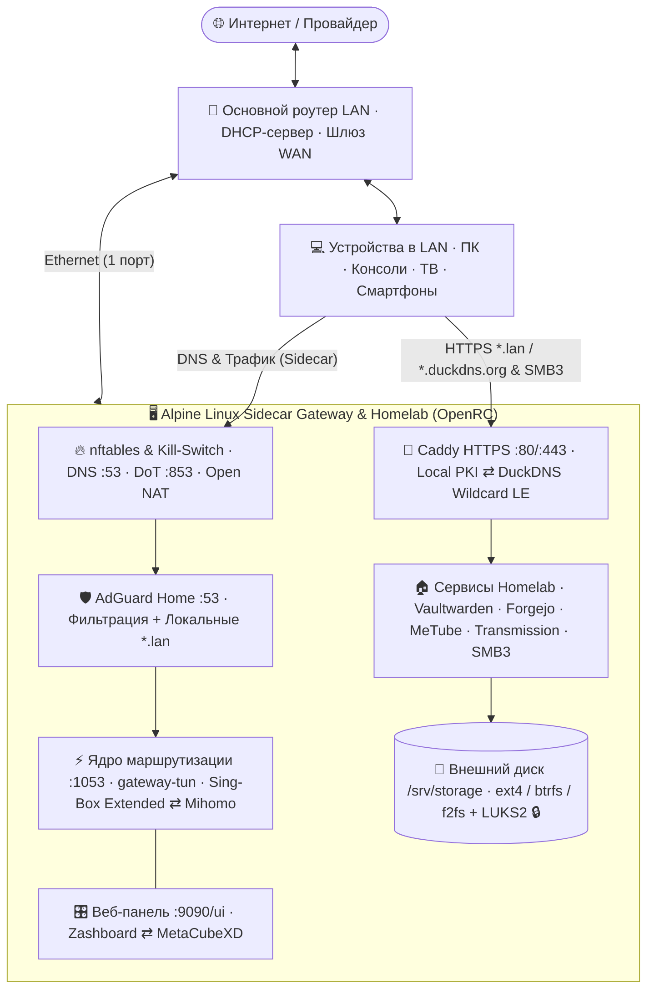

<div align="center">

# 🚀 Universal Sidecar Gateway & Homelab

### Превратите любой мини-ПК с одним Ethernet-портом в бесшумный сетевой шлюз, отказоустойчивое домашнее облако и платформу LXC на базе чистого Alpine Linux

<p>
  <a href="README.md"></a>
  <a href="#-быстрый-старт-за-2-минуты"></a>
  <a href="#-правовая-оговорка"></a>
</p>

[](https://github.com/unknownpeace/lol/actions/workflows/ci.yml)
[](https://alpinelinux.org)
[](https://wiki.alpinelinux.org/wiki/OpenRC)
[](https://github.com/shtorm-7/sing-box-extended)
[](https://github.com/MetaCubeX/mihomo)
[](https://github.com/AdguardTeam/AdGuardHome)
[](https://github.com/Zephyruso/zashboard)
[](#-отказоустойчивость-и-шифрование-luks2)
[](LICENSE)

</div>

> **Редакция от 20 ноября 2026 г.** · Нативный стек **Alpine Linux + OpenRC + `apk`** — без Docker, без Snap, без `opkg` и лишних прослоек. Создано для мини-ПК (**Z83II**, Intel N100/N95), одноплатников (**Raspberry Pi**, **Orange Pi**, **NanoPi**) и виртуальных машин.

---

## ✨ Почему именно этот проект?

Обычные домашние сборки либо тянут гигабайты Docker-контейнеров на слабом железе, либо ломаются при первом обрыве электричества или смене сетевого окружения. **Universal Sidecar Gateway & Homelab** проектировался как автономный *appliance*-комплекс для работы 24/7 за обычным домашним роутером:

| | Возможность | Что это даёт на практике |
|---|---|---|
| ⚡ | **~130–200 МБ ОЗУ в работе** | Все службы работают как нативные демоны OpenRC с контролем `cgroups v2` и адаптивным `GOMEMLIMIT` |
| 🔌 | **Single-NIC Sidecar из коробки** | Безопасное подключение в существующую LAN через 1 Ethernet-кабель без замены основного роутера и без конфликта DHCP |
| 🔄 | **Двойное ядро + Двойной Web UI** | Горячее переключение **Sing-Box Extended ⇄ Mihomo** (с авто-валидацией и откатом) и **Zashboard ⇄ MetaCubeXD** (без рестарта ядра) |
| 🎮 | **Игровой режим и QoS-маршрутизация** | Игры по умолчанию идут напрямую (`DIRECT`), игровые патчи CDN — всегда напрямую, `masquerade persistent` для Open NAT |
| 🔒 | **Шифрование дисков LUKS2 + Mount Guard** | USB/SATA/NVMe диски под `AES-XTS 512-bit + Argon2id`. Если диск отключён — шлюз, DNS и Vaultwarden продолжают работать |
| 🛡️ | **Самоисцеление после сбоев питания и сети** | Загрузочный хук Boot Guard + Watchdog восстанавливают повреждённые конфиги из `.last_good_state`, сбрасывают `conntrack` и лечат маршрут при флапе линка |
| 🏠 | **Модульный Homelab за 1 минуту** | Vaultwarden, Forgejo Git, Samba SMB3 + WSDD + Avahi, MeTube, Transmission, VS Code Web и автоматический HTTPS (`Local PKI ⇄ DuckDNS Let's Encrypt`) |

---

## 🏗️ Сетевая архитектура (Single-NIC Sidecar + Homelab)

Шлюз располагается рядом с основным роутером (`192.168.1.5`) в той же локальной сети. Роутер по DHCP выдаёт устройствам в качестве шлюза и DNS-сервера адрес узла Alpine Linux, а сам шлюз аккуратно фильтрует DNS-трафик и распределяет пакеты по заданным политикам.



### Сетевая гигиена на одном интерфейсе
* **Защита от конфликта DHCP:** в режиме Sidecar DHCP в AdGuard Home отключён; при попытке активации автоматически запускается `detect_external_dhcp_server`.
* **Отсутствие петель маршрутизации:** на LAN-интерфейсе отключаются ICMP Redirects (`send_redirects=0`, `accept_redirects=0`, `secure_redirects=0`) и `rp_filter=0`, включаются `nf_conntrack_tcp_be_liberal=1`, очередь `fq_codel` и алгоритм **TCP BBR**.
* **Аппаратный `gw killswitch`:** при включении строго ограничивает форвардинг клиентского трафика интерфейсом `gateway-tun`, оставляя локальные подсети RFC1918/CGNAT и SSH полностью доступными.

---

## 🔄 Двойное ядро и две веб-панели на выбор

Выбирайте стек при установке или переключайтесь в любую секунду одной командой в CLI / TUI-меню:

| Компонент | Вариант 1 (по умолчанию) | Вариант 2 | Особенность переключения |
|---|---|---|---|
| **Ядро шлюза** | **Sing-Box Extended `v1.14.3`**<br>Native JSON + AWG 2.0 + MASQUE H2 | **Mihomo `v1.19.34`** *(Clash Meta)*<br>Нативный YAML + `.mrs` rule-providers | `gw core [singbox\|mihomo]`<br>Проверка синтаксиса до остановки старого ядра + авто-откат |
| **Веб-панель** | **Zashboard `v3.30.0`**<br>Лёгкий современный интерфейс | **MetaCubeXD `v1.275.2`**<br>Классическая панель экосистемы Clash | `gw ui [zashboard\|metacubexd]`<br>Мгновенная смена UI на `:9090/ui` с **0 рестартов ядра** |

> Оба ядра читают единый источник правил в [lib/routing_rules.sh](lib/routing_rules.sh), создают виртуальный интерфейс `gateway-tun` (`MTU 1400`, `stack: system`) и поддерживают **3 независимых слота апстримов**:
> 1. **Слот 1:** Подписки по HTTP/HTTPS (`custom_sub`).
> 2. **Слот 2:** Локальные URI-конфигурации (`my_nodes.yaml`).
> 3. **Слот 3:** Встроенный клиент **Cloudflare WARP / AmneziaWG 2.0 + TCP MASQUE H2** (`warp_nodes.json`).

---

## 🎯 Политики маршрутизации и QoS для дома

Трафик разных типов приложений разделяется по независимым селекторам, чтобы снижать задержки в играх, сохранять максимальную скорость загрузок и гибко управлять каналами для каждого класса сервисов:

| Группа / Селектор | Какой трафик обслуживает | Выбор по умолчанию | Доступные варианты в Web UI |
|---|---|---|---|
| **`⚡ Авто (Самый быстрый)`** | Автоматический пул (`urltest`, допуск `35 ms`) по активным узлам | Наименьшая задержка | Авто-подбор среди валидных узлов |
| **`🤖 Нейросети (ИИ)`** | ChatGPT / OpenAI, Claude, Gemini, AI Studio, Antigravity, Perplexity, xAI/Grok, Cursor, Copilot и др. + выделенный DoH (`dns_ai`) | **`🤖 Авто-ИИ`** | `🇺🇸 США`, `🇩🇪 Германия`, `⚡ Авто`, любая нода |
| **`🇩🇪 Германия`** | Немецкий региональный шлюз (`🇩🇪 Авто-DE`) | **`🇩🇪 Авто-DE`** | Ручной выбор конкретного узла DE |
| **`🇺🇸 США`** | Американский региональный шлюз (`🇺🇸 Авто-US`) | **`🇺🇸 Авто-US`** | Ручной выбор конкретного узла US |
| **`🎮 Гейминг`** | Steam, Epic Games, Riot, EA, Ubisoft, Blizzard, PSN, Xbox, Nintendo | **`DIRECT`** | В 1 клик в `🎮 Авто-Гейминг` или `🇩🇪 Германия` |
| **`🧱 Roblox`** | Выделенная политика для сервисов Roblox (`roblox.com`, `rbxcdn.com`) | **`🇩🇪 Германия`** | `⚡ Авто`, `🇺🇸 США`, `🎮 Авто-Гейминг`, `DIRECT` |
| **`💬 Мессенджеры`** | Telegram, WhatsApp, Discord (включая голосовые каналы) | **`⚡ Авто`** | `🇩🇪 Германия`, `🇺🇸 США`, `DIRECT` |
| **`▶️ YouTube & Медиа`** | YouTube, **Twitch** (`twitch.tv`, `ttvnw.net`), **Spotify** (`spotify.com`, `scdn.co`) | **`⚡ Авто`** | `🇩🇪 Германия`, `🇺🇸 США`, `DIRECT` |
| **`🧲 Торренты`** | Протокол BitTorrent, трекеры (`torrent_domain`), порты `6881–6889`, `51413` | **`DIRECT`** | В 1 клик в `🇩🇪 Германия`, `🇺🇸 США`, `⚡ Авто` или ноду |
| **`🌐 Google & Android`** | Обычные сервисы Google и обновления систем (строго после ИИ-правил) | **`DIRECT`** | `⚡ Авто`, `🇩🇪 Германия`, `🇺🇸 США` |
| **`🌐 Остальной трафик`** | Политика по умолчанию для прочего трафика | **`DIRECT`** | Любой пул или узел |

### Инженерные детали DNS и сетевого стека
* **Гибридный DNS:** локальный **AdGuard Home** (`:53`, `ratelimit: 0`, авто-rewrites `*.lan`) передаёт внешние запросы ядру (`127.0.0.1:1053`), где **FakeIP (`198.18.0.0/15`)**, `dns_hosts` для `.lan` и изолированный **DoH** (`dns_ai`, `dns_proxy`, `dns_ru`, `dns_bootstrap`) исключают DNS-утечки и конфликты.
* **Реальные IP для игровых платформ:** Steam, PSN, Xbox, Battle.net, Epic и Riot резолвятся без FakeIP, чтобы античиты, P2P-матчмейкинг и NAT работали предсказуемо; крупные игровые CDN-загрузки (`steamcontent.com`, `akamaized.net`) всегда идут через `DIRECT`.
* **Гибкое управление по доменам:** `gw domain direct <url|домен>`, `gw domain proxy <url|домен>` и рентген маршрута `gw domain test <домен>` (проверяет резолв `:53` и фактический HTTPS/TLS-пинг).

---

## 🏠 Модульная экосистема Homelab и SSL

Все веб-приложения привязаны строго к `127.0.0.1` и публикуются в домашнюю сеть через **Caddy Reverse Proxy** с автоматическим HTTPS. Доступно переключение сертификатов в один клик (**Local PKI ⇄ DuckDNS Let's Encrypt Wildcard** с умным переиспользованием действующего сертификата):

| № | Модуль | Назначение | Локальный HTTPS / Путь | Внешний DNS (`DuckDNS`) | Порт |
|---|---|---|---|---|---|
| **`1`** | **Caddy & Local PKI** | Reverse Proxy + портал корневого сертификата для Windows/Linux/Android | `http://ca.lan` · `https://panel.lan` | `https://zashboard.<sub>.duckdns.org` | `:80` / `:443` |
| **`2`** | **Samba SMB3 + WSDD + Avahi** | Сетевая шара с обзором в Проводнике Windows 11 и Linux/macOS | `\\homelab\storage` | — *(локальная сеть)* | `:445` |
| **`3`** | **Vaultwarden** | Приватный менеджер паролей, совместимый с клиентами Bitwarden | `https://vaultwarden.lan` | `https://vaultwarden.<sub>.duckdns.org` | `127.0.0.1:8222` |
| **`4`** | **Forgejo** | Лёгкий собственный Git-сервер с веб-интерфейсом и Issues/PR | `https://forgejo.lan` | `https://forgejo.<sub>.duckdns.org` | `127.0.0.1:3001` |
| **`5`** | **VS Code Server** | Полноценная IDE в браузере для редактирования конфигов и проектов | `https://code.lan` | `https://code.<sub>.duckdns.org` | `127.0.0.1:8443` |
| **`6`** | **MeTube (`yt-dlp`)** | Загрузчик видео и аудио прямо в папки `Videos` и `Music` на диске | `https://downloads.lan` | `https://downloads.<sub>.duckdns.org` | `127.0.0.1:8081` |
| **`7`** | **Transmission** | Фоновый BitTorrent-клиент с веб-интерфейсом под BasicAuth | `https://torrents.lan` | `https://torrents.<sub>.duckdns.org` | `127.0.0.1:9091` |

> **Единая ротация паролей:** команда `gw passwd <новый_пароль>` синхронно обновляет доступ сразу для Clash API (`:9090`), AdGuard Home (`:3000`), Samba (`homelab`), Vaultwarden `/admin`, Transmission RPC и Caddy BasicAuth.

---

## 🛡️ Отказоустойчивость и шифрование LUKS2

Архитектура рассчитана на домашнюю эксплуатацию без ИБП и регулярного присмотра:

* **Шифрование дисков LUKS2 (`gw disk`):** форматирование в `ext4`, `btrfs` (`zstd:3` + подтома) или `f2fs` поверх `AES-XTS 512-bit + Argon2id`, защита системного диска от случайного выбора, интеграция с нативным OpenRC-сервисом `dmcrypt`, авто-открытие криптоконтейнера по keyfile (`0400`) и безопасная парковка `gw lock` / `gw unlock` / `gw safe-poweroff`.
* **Boot Guard (`/etc/local.d/50-gateway-boot-guard.start`):** при старте системы после аварийного выключения питания автоматически очищает зависшие lock-файлы, восстанавливает повреждённые нулевые конфиги из персистентного снимка `.last_good_state`, монтирует LUKS2-хранилище и поднимает службы.
* **Mount Guard (Защита корневой флешки):** если зашифрованный внешний диск физически отсоединён или закрыт, **шлюз, AdGuard Home, Caddy и Vaultwarden продолжают работать**, а тяжёлые дисковые службы (`samba`, `wsdd`, `forgejo`, `metube`, `transmission`) удерживаются в безопасной паузе до подключения диска.
* **Watchdog & Самолечение сети (`gw doctor`):** автоматическое восстановление пропавшего маршрута по умолчанию `default via <router>` при флапе линка, сброс `conntrack`, перезагрузка провайдеров при сбое сети и контроль состояния `wsdd`.
* **Горячие бэкапы (`gw backup create / restore`):** единый архив (`0600`) с консистентными дампами БД SQLite (`sqlite3 .backup` для Vaultwarden и Forgejo), всеми ключами, сертификатами ACME и конфигурациями — сохраняется локально, на внешний диск и при желании отправляется в Telegram (`gw backup telegram`).

---

## 📦 Нативная виртуализация LXC

Встроенный диспетчер `gw lxc` позволяет поднимать изолированные Linux-контейнеры (Alpine, Debian, Ubuntu, Arch и др.) поверх чистых rootfs-шаблонов без тяжёлой среды Docker:
* Выбор сетевого моста `lxcbr0` (NAT) или выделенного IP в LAN (`macvlan`).
* Создание и мгновенный откат снапшотов (`gw lxc snap`).
* Контроль памяти, автозапуска и сетевое автоисцеление (`gw lxc doctor` / `gw lxc fix-net`).

---

## ⚡ Быстрый старт за 2 минуты

Подключитесь по SSH к чистому **Alpine Linux** под пользователем `root`:

### Способ 1: Интерактивный мастер (рекомендуется)
```sh
apk add --no-cache git
git clone https://github.com/unknownpeace/lol.git /opt/gateway
cd /opt/gateway
./setup.sh
```

### Способ 2: Тихая автоматическая установка (Zero-Touch)
```sh
# Сгенерировать готовый шаблон конфигурации
gw answers template /root/gateway.answers

# Проверить синтаксис файла ответов и развернуть всё без единого вопроса
gw answers verify /root/gateway.answers
gw install --answers /root/gateway.answers
```

После установки откройте единый пульт управления командой **`gw`** (или **`gateway`**):

```text
╔══════════════════════════════════════════════════════════════════════════════╗
║  🚀 UNIVERSAL SIDECAR GATEWAY & HOMELAB // ALPINE LINUX
╠══════════════════════════════════════════════════════════════════════════════╣
║  • Хост / ОС:    homelab (x86_64)         │ Uptime: 4d 12h     │ Load: 0.14 0.18 0.12
║  • Сеть:         LAN: 192.168.1.10 (eth0) │ Роутер: 192.168.1.5
║  • Память (RAM): 168 МБ / 1940 МБ (8%)
║  • Хранилище:    /srv/storage: 12G / 465G (3%) [ext4 / LUKS2 🔒]
║  • Ядро шлюза:   Sing-Box Extended [●] │ AdGuard Home (:53) [●] │ gateway-tun [●] │ UI: Zashboard
║  • Homelab:      caddy[●] samba[●] vaultwarden[●] forgejo[●] ytdlp[●] torrent[●]
║  • SSL / Домен:  Let's Encrypt Wildcard (*.example.duckdns.org)
║  • Обновление:   v2026.11 (Git) [актуальна ●]
╚══════════════════════════════════════════════════════════════════════════════╝
```

---

## 🛠️ Справочник основных команд CLI

<details>
<summary><b>Нажмите, чтобы развернуть полный список команд <code>gw</code> (CLI & TUI)</b></summary>

```sh
# Диагностика и управление состоянием
gw                                # Главное интерактивное TUI-меню с телеметрией
gw status                         # Self-Test 2.0: матрица служб, групп, DNS Anti-Leak и пинг
gw check                          # Неинвазивный аудит синтаксиса конфигов, SSL, ОЗУ и conntrack
gw doctor                         # Полная авто-починка сети, модулей ядра, правил nftables, БД и LUKS2
gw motd                           # Быстрая сводка состояния шлюза и сервисов
gw links                          # Карточка всех HTTPS-адресов и сетевых путей Samba
gw logs [core|caddy|adguard|...]  # Живые журналы любой службы (или: gw logs core 100)
gw restart                        # Безопасная пересборка конфигурации и перезапуск с очисткой conntrack
gw update [check]                 # Атомарное 5-стадийное обновление скриптов Git и бинарников

# Ядра, панели и безопасность трафика
gw core [singbox|mihomo|status]   # Горячее переключение ядра с валидацией и авто-откатом
gw ui [zashboard|metacubexd]      # Мгновенная смена веб-панели без рестарта ядра
gw killswitch [on|off|status]     # Аппаратный nftables Kill-Switch (строгий форвардинг в TUN)
gw ssl [status|local|renew]       # Управление SSL: Local PKI (*.lan) или Let's Encrypt DuckDNS
gw ssl duckdns <sub> <token>       # Выпуск или быстрое переиспользование Wildcard-сертификата
gw passwd [новый_пароль]          # Синхронная смена мастер-пароля во всех сервисах

# Гибкая маршрутизация и апстримы
gw proxy                          # Интерактивный выбор активного узла в группах прямо из SSH
gw proxy add <url|uri|warp>       # Подключение подписки (Слот 1), URI (Слот 2) или WARP (Слот 3)
gw domain direct <url|домен>      # Направить домен всегда напрямую (DIRECT)
gw domain proxy <url|домен>       # Направить домен через пользовательский прокси-список
gw domain test <домен>            # Трассировка DNS (:53) и реального TLS-отклика

# Диски LUKS2, бэкапы и безопасное питание
gw disk                           # Мастер разметки, форматирования и шифрования дисков LUKS2
gw unlock / gw lock               # Открыть криптоконтейнер LUKS2 или закрыть с остановкой служб
gw backup [create|full|restore]   # Консистентный бэкап (конфиги + дампы SQLite + сертификаты)
gw safe-reboot / gw safe-poweroff # Корректный останов БД, сброс кэша дисков и выключение

# Виртуализация LXC и автоустановка
gw lxc [list|create|start|stop]   # Управление нативными LXC-контейнерами
gw lxc snap <имя> [create|restore]# Снапшоты и откат контейнеров
gw answers [template|verify]      # Шаблон и проверка конфигурации автоустановки
```

</details>

---

## 💻 Системные требования и документация

| Параметр | Минимум | Рекомендуется для полного Homelab |
|---|---|---|
| **ОС** | **Alpine Linux 3.21 – 3.24+** (x86_64 / aarch64) | Alpine Linux 3.24+ (Standard / Extended) |
| **Процессор** | 1–2 ядра x86_64 или ARM64 | Intel Atom Z8350 (Z83II), Intel N100/N95, ARMv8 |
| **Память (RAM)** | 512 МБ *(только шлюз + DNS)* | 1.5–4 ГБ *(шлюз + весь Homelab + LXC)* |
| **Диск (ОС + Логи)** | 2 ГБ *(проверено с журналом и кэшем)* | 16 ГБ+ eMMC/SSD + внешний диск под LUKS2 |

* 📘 Подробная архитектура модулей и контракты ядра описаны в [ARCHITECTURE.md](ARCHITECTURE.md).
* 🤖 Руководство для разработчиков и автоматизированной поддержки — в [AGENTS.md](AGENTS.md).

---

## ⚖️ Правовая оговорка

> Данный репозиторий представляет собой **открытый инструментарий для администрирования локальной сети, DNS-фильтрации, QoS-маршрутизации трафика, шифрования накопителей и оркестрации собственного домашнего сервера (Homelab)** на базе Alpine Linux.
>
> * В состав проекта **не входят** какие-либо сторонние серверы, прокси-ноды, учётные записи, подписки, ключи доступа или инструкции по преодолению каких-либо законодательных ограничений.
> * Пользователь самостоятельно настраивает источники подключения и правила маршрутизации в рамках своей частной или корпоративной инфраструктуры и несёт полную единоличную ответственность за законность и цели использования программного обеспечения в соответствии с применимым законодательством своей страны.

---

<div align="center">

**Universal Sidecar Gateway & Homelab** распространяется под свободной лицензией [MIT License](LICENSE).

</div>
