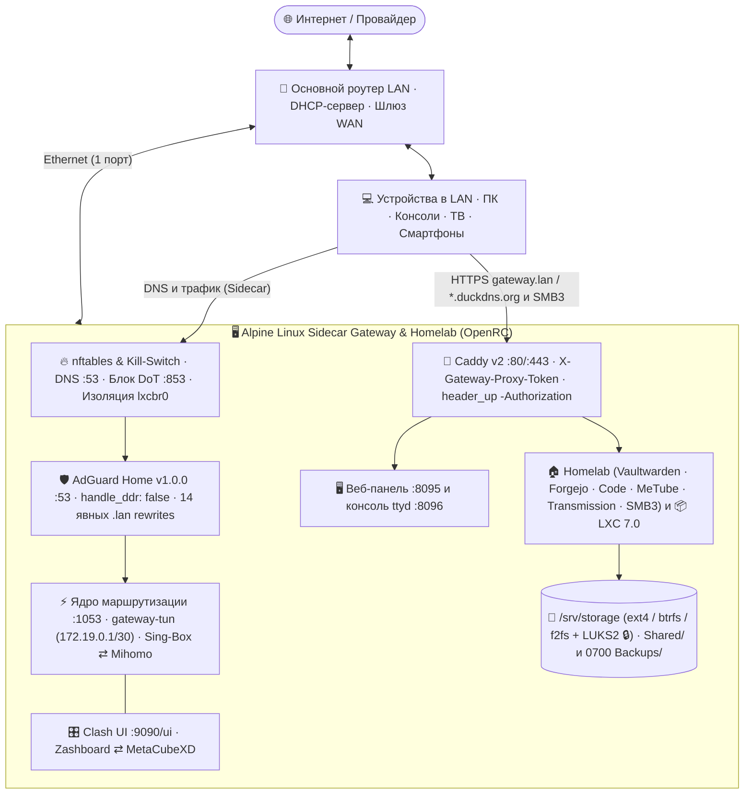

<div align="center">

# 🚀 Universal Sidecar Gateway & Homelab

### Превратите любой мини-ПК на Alpine Linux или роутер OpenWrt >= 25.12.6 в бесшумный сетевой шлюз с DNS-фильтрацией рекламы, современной веб-панелью и (на Alpine) модульным домашним сервером с LXC 7.0 Studio

<p>
  <a href="README.md"></a>
  <a href="#-быстрый-старт-за-2-минуты"></a>
  <a href="#-faq-и-решение-частых-проблем"></a>
  <a href="#-правовая-оговорка"></a>
</p>

[](https://github.com/unknownpeace/lol/actions/workflows/ci.yml)
[](https://alpinelinux.org)
[-00B5E2?logo=openwrt&logoColor=white)](https://openwrt.org)
[-2ea043)](https://wiki.alpinelinux.org/wiki/OpenRC)
[](https://github.com/shtorm-7/sing-box-extended)
[](https://github.com/MetaCubeX/mihomo)
[](https://github.com/AdguardTeam/AdGuardHome)
[](#-веб-панель-lxc-70-studio-и-openwrt-luci)
[](#-отказоустойчивость-шифрование-luks2-и-lxc-70)
[](LICENSE)

</div>

> **Релиз `v2026.11.2` (22 ноября 2026 г.).** Нативный стек **`apk`-only** для **Alpine Linux 3.23–3.24+ (OpenRC + cgroups v2)** и **OpenWrt `>= 25.12.6` (`procd` + `fw4` + нативный LuCI SPA)** — без Docker-демона, без Snap и без устаревшего `opkg`. Создано для мини-ПК (**Z83II**, Intel N100/N95), одноплатников (**Raspberry Pi**, **Orange Pi**, **NanoPi**), x86/ARM64 роутеров и виртуальных машин.

---

## 🎯 Два сфокусированных профиля платформ

| Возможность | Alpine Linux (`3.23 – 3.24+`, OpenRC) | OpenWrt (`>= 25.12.6`, `procd` + `fw4` + `apk`) |
|---|---|---|
| **Сетевой шлюз** (`Sing-Box Extended ⇄ Mihomo`, `Zashboard ⇄ MetaCubeXD`, WARP 2.0) | ✅ Полностью | ✅ Полностью |
| **DNS и фильтрация рекламы** (`AdGuard Home v1.0.0` `:53`/`:3000`, `handle_ddr: false`, явные `.lan` rewrites) | ✅ Полностью (14 управляемых `.lan` имён) | ✅ Полностью (6 имён; `dnsmasq` уступает `:53`; **LuCI `:80` сохранён**) |
| **Интерфейсы управления** | ✅ **Веб-панель Alpine (`:8095`)** + **Консоль `ttyd` (`:8096`)** + `gw` TUI/CLI | ✅ **Нативный LuCI SPA (`admin/gateway`)** + `gw` TUI/CLI |
| **Отказоустойчивость и защита** (`Kill-Switch`, `Doctor`, `Watchdog`, `SelfTest`, `passwd`, `backup`) | ✅ Нативный `nftables` + изоляция `lxcbr0` | ✅ Нативный `fw4` (`/etc/nftables.d/90-gateway.nft`) + защита от конфликта IP |
| **Homelab, Caddy PKI/SSL, шифрование LUKS2 и LXC 7.0 Studio** | ✅ Полностью | ⛔ Исключено по дизайну (ничего лишнего на роутере) |
| **Устаревшие сборки `< 25.12.6` / `opkg`** | — | ❌ Отклоняются при проверке ОС |

---

## ✨ Почему именно этот проект?

Обычные домашние сборки либо тянут гигабайты Docker-контейнеров на слабом железе, либо ломаются при первом обрыве электричества или смене сетевого окружения. **Universal Sidecar Gateway & Homelab** проектировался как автономный *appliance*-комплекс для работы 24/7 за обычным домашним роутером:

| | Возможность | Что это даёт на практике |
|---|---|---|
| ⚡ | **Минимальное потребление ОЗУ** | `~130–200 МБ` для шлюза и DNS (`~220–320 МБ` с веб-панелью Alpine и Caddy) + адаптивный `GOMEMLIMIT` вплоть до роутеров с 256 МБ ОЗУ |
| 🖥️ | **Веб-панель нового поколения и LuCI SPA** | Темы **Obsidian Glass / Porcelain Slate** (`:8095`), быстрая телеметрия `<250 мс`, палитра `Ctrl+K`, нижнее мобильное меню и нативный модуль **LuCI** на OpenWrt |
| 🔄 | **Двойное ядро + Двойной Clash UI** | Горячее переключение **Sing-Box Extended ⇄ Mihomo** (с авто-валидацией и откатом) и **Zashboard ⇄ MetaCubeXD** (0 рестартов ядра) |
| 📦 | **LXC 7.0 Container Studio + веб-терминал `ttyd`** | Мастер создания контейнеров (Alpine/Debian/Ubuntu/Arch) в 3 шага, снапшоты, клонирование, лимиты CPU/ОЗУ и встроенная root-консоль (`:8096`) по одноразовым токенам |
| 🎮 | **Игровой режим и QoS-маршрутизация** | Игры по умолчанию идут напрямую (`DIRECT`) с реальными IP (без FakeIP для античитов и NAT), игровые CDN — всегда напрямую, `masquerade persistent` Open NAT |
| 🔒 | **Эшелонированная безопасность и LUKS2** | `X-Gateway-Proxy-Token` + `header_up -Authorization`, изоляция `/run/gateway` (`0700`), общий доступ строго к `/srv/storage/Shared`, `0700` `Backups/` без LUKS-ключей, RAM-безопасный Argon2id |
| 🛡️ | **Самоисцеление после сбоев питания и сети** | Boot Guard + OpenRC Mount Guard + Watchdog восстанавливают конфиги из `.last_good_state`, сохраняют работу DNS/Vaultwarden без внешнего диска и лечат сеть/`conntrack` |

---

## 🖥️ Веб-панель, LXC 7.0 Studio и OpenWrt LuCI

### Веб-панель Alpine Linux (`https://gateway.lan` · `:8095`) и консоль `ttyd` (`:8096`)
Лёгкая панель управления без Node.js, npm и внешних CDN (`modules/webui/server.py` + чистый HTML/CSS/JS):
- **Быстрый нативный `/api/status`:** Собирает состояние системы, OpenRC, дисков, Clash API, AdGuard Home и LXC напрямую из Python 3 stdlib (`<250 мс` в прогретом режиме).
- **Дизайн Obsidian Glass (тёмная) и Porcelain Slate (светлая):** Однострочный закреплённый заголовок на десктопе, быстрый поиск и команды по **`Ctrl+K` / `/`**, сворачиваемый **чек-лист первого запуска**, подсказки `?`, интерактивная 4-узловая схема трафика, радиальные шкалы и графики, а также **мобильная нижняя навигация** (`<=640px`, без горизонтальной прокрутки).
- **Прокси, рентген доменов и живые логи:** Редактор апстримов (Слот 1→2→3), проверка DNS и TLS-пинга доменов (Domain X-Ray), переключатели Kill-Switch / DHCP / Cron, просмотр логов с подсветкой уровней и управление SSL / LUKS2 в один клик.
- **LXC 7.0 Container Studio:** 3-шаговый мастер создания контейнеров (живой каталог `images.linuxcontainers.org` + офлайн-список), сеть `lxcbr0` (NAT) или прямой LAN `macvlan`, лимиты CPU/RAM, снапшоты и откат, клонирование с новым MAC, Quick Exec и встроенный **браузерный терминал `ttyd`** (`127.0.0.1:8096`) с одноразовыми 60-секундными токенами в `/run/gateway/console_tokens`.
- **Защищённая авторизация:** За Caddy (`AUTH_MODE="caddy"`) работает bcrypt `basic_auth` + `header_up -Authorization` + проверка `X-Gateway-Proxy-Token` за постоянное время. Без Caddy (`AUTH_MODE="basic"`) включается BasicAuth с экспоненциальной блокировкой перебора по IP (`HTTP 429`).

### Нативный интерфейс OpenWrt LuCI SPA (`luci-app-gateway`)
На **OpenWrt >= 25.12.6** установщик `./setup.sh` автоматически добавляет раздел **Sidecar Gateway** (`admin/gateway`) прямо в стандартный LuCI (`uhttpd :80`) с 5 вкладками:
1. **Обзор** — статус ядра, `gateway-tun`, AdGuard Home, аренды DHCP и нагрузка ОЗУ/conntrack.
2. **Ядро и сеть** — переключение Sing-Box ⇄ Mihomo и Zashboard ⇄ MetaCubeXD, Kill-Switch, DHCP, статический IP/шлюз.
3. **Прокси и маршруты** — многострочный ввод подписок, локальные URI-ноды, WARP 2.0, правила доменов/устройств и Domain X-Ray.
4. **Telegram и бэкап** — уведомления в Telegram, резервное копирование/восстановление и смена мастер-пароля.
5. **Обновление и логи** — обновление Git/бинарников и просмотр логов через асинхронные задачи `rpcd`/`ubus` (`job_start`/`job_poll`).

---

## 🏗️ Сетевая архитектура (Single-NIC Sidecar + Homelab)

Шлюз располагается рядом с основным роутером (`192.168.1.5`) в той же локальной сети. Роутер по DHCP выдаёт устройствам адрес шлюза в качестве основного шлюза и DNS-сервера.



### Сетевая гигиена на одном интерфейсе
* **Защита от конфликта DHCP:** в режиме Sidecar DHCP в AdGuard Home выключен; при включении проверяется наличие стороннего DHCP (`detect_external_dhcp_server`) и конфликта IP (`check_ip_conflict_on_lan`).
* **Отсутствие петель маршрутизации:** на LAN-интерфейсе отключаются ICMP Redirects (`send_redirects=0`, `accept_redirects=0`, `secure_redirects=0`) и `rp_filter=0`, включаются `nf_conntrack_tcp_be_liberal=1`, очередь `fq_codel` и алгоритм **TCP BBR**.
* **Аппаратный `gw killswitch`:** строго ограничивает форвардинг клиентского трафика (включая `lxcbr0`) интерфейсом `gateway-tun`, оставляя локальные подсети RFC1918 и SSH доступными.

---

## 🔄 Двойное ядро и две Clash-панели на выбор

Выбирайте стек при установке или переключайтесь в любую секунду через веб-панель, LuCI или CLI/TUI:

| Компонент | Вариант 1 (по умолчанию) | Вариант 2 | Особенность переключения |
|---|---|---|---|
| **Ядро шлюза** | **Sing-Box Extended `v1.14.3-extended-2.7.3`**<br>Native JSON + AWG 2.0 + MASQUE H2 + `.srs` | **Mihomo `v1.19.34`** *(Clash Meta)*<br>Нативный YAML + AWG + `.mrs` rule-providers | `gw core [singbox\|mihomo]`<br>Проверка синтаксиса до остановки старого ядра + авто-откат |
| **Clash-панель** | **Zashboard `v3.30.0`**<br>Лёгкий современный интерфейс | **MetaCubeXD `v1.275.2`**<br>Классическая панель экосистемы Clash | `gw ui [zashboard\|metacubexd]`<br>Мгновенная смена UI на `:9090/ui` с **0 рестартов ядра** |

> Оба ядра читают единый источник правил в [lib/routing_rules.sh](lib/routing_rules.sh), поднимают `gateway-tun` (`172.19.0.1/30`, `MTU 1400`, `stack: system`, `auto_redirect: true`), проверяют бинарники по SHA-256 (fail-closed) и поддерживают **3 независимых слота апстримов**:
> 1. **Слот 1:** Подписки по HTTP/HTTPS (`custom_sub`).
> 2. **Слот 2:** Локальные URI-конфигурации (`my_nodes.yaml`).
> 3. **Слот 3:** Встроенный клиент **Cloudflare WARP 2.0 / AmneziaWG + TCP MASQUE H2** (`warp_nodes.json`).

---

## 🎯 Политики маршрутизации и QoS для дома

| Группа / Селектор | Какой трафик обслуживает | Выбор по умолчанию | Доступные варианты в Web UI |
|---|---|---|---|
| **`⚡ Авто (Самый быстрый)`** | Автоматический пул (`urltest`, допуск `35 ms`, fail-closed заглушка) | Наименьшая задержка | Авто-подбор среди валидных узлов |
| **`🤖 Нейросети (ИИ)`** | ChatGPT / OpenAI, Claude, Gemini, AI Studio, Antigravity, Perplexity, xAI/Grok, Cursor, Copilot и др. + выделенный DoH (`dns_ai`) | **`🤖 Авто-ИИ`** | `🇺🇸 США`, `🇩🇪 Германия`, `⚡ Авто`, любая нода |
| **`🇩🇪 Германия`** | Немецкий региональный шлюз (`🇩🇪 Авто-DE`) | **`🇩🇪 Авто-DE`** | Ручной выбор конкретного узла DE |
| **`🇺🇸 США`** | Американский региональный шлюз (`🇺🇸 Авто-US`) | **`🇺🇸 Авто-US`** | Ручной выбор конкретного узла US |
| **`🎮 Гейминг`** | Steam, Epic Games, Riot, EA, Ubisoft, Blizzard, PSN, Xbox, Nintendo | **`DIRECT`** | В 1 клик в `🎮 Авто-Гейминг` или `🇩🇪 Германия` |
| **`🧱 Roblox`** | Выделенная политика для сервисов Roblox (`roblox.com`, `rbxcdn.com`) | **`🇩🇪 Германия`** | `⚡ Авто`, `🇺🇸 США`, `🎮 Авто-Гейминг`, `DIRECT` |
| **`💬 Мессенджеры`** | Telegram, WhatsApp, Discord (включая голосовые каналы) | **`⚡ Авто`** | `🇩🇪 Германия`, `🇺🇸 США`, `DIRECT` |
| **`▶️ YouTube & Медиа`** | YouTube, **Twitch** (`twitch.tv`, `ttvnw.net`), **Spotify** (`spotify.com`, `scdn.co`) | **`⚡ Авто`** | `🇩🇪 Германия`, `🇺🇸 США`, `DIRECT` |
| **`🧲 Торренты`** | Протокол BitTorrent, трекеры (`torrent_domain`), порты `6881–6889`, `51413` | **`DIRECT`** | В 1 клик в `🇩🇪 Германия`, `🇺🇸 США`, `⚡ Авто` или ноду |
| **`🌐 Google & Android`** | Обычные сервисы Google и обновления систем (строго после ИИ-правил) | **`DIRECT`** | `⚡ Авто`, `🇩🇪 Германия`, `🇺🇸 США` |
| **`📺 Устройства (Full-VPN)`** | Динамическая группа для IP из `force_proxy_devices.conf` (высший приоритет, вкл. DNS и QUIC) | Активный прокси-пул | Создаётся автоматически при добавлении Full-VPN устройства |
| **`🌐 Остальной трафик`** | Политика по умолчанию для прочего трафика | **`DIRECT`** | Любой пул или узел |

### Инженерные детали DNS и сетевого стека
* **Гибридный DNS:** локальный **AdGuard Home v1.0.0** (`:53`, `ratelimit: 0`, **`handle_ddr: false`**, 14 явных `.lan` rewrites на Alpine / 6 на OpenWrt) передаёт внешние запросы ядру (`127.0.0.1:1053`), где **FakeIP (`198.18.0.0/15`)**, `dns_homelab` (только `A`) и изолированный **DoH** (`dns_ai`, `dns_proxy`, `dns_ru`, `dns_bootstrap`) исключают утечки и конфликты.
* **Реальные IP для игровых платформ:** Steam, PSN, Xbox, Battle.net, Epic и Riot резолвятся через `dns_ru` без FakeIP, чтобы античиты, P2P-матчмейкинг и NAT работали предсказуемо; крупные игровые CDN (`steamcontent.com`, `akamaized.net`) всегда идут `DIRECT`.
* **Гибкое управление по доменам:** `gw domain direct <домен>`, `gw domain proxy <домен>` и рентген маршрута `gw domain test <домен>` (или **Domain X-Ray** в веб-панели / LuCI).

---

## 🏠 Модульная экосистема Homelab и SSL (Alpine Linux)

Все веб-приложения привязаны строго к `127.0.0.1` и публикуются в домашнюю сеть через **Caddy v2** (`Local PKI http://ca.lan` ⇄ `DuckDNS Let's Encrypt EC-256 Wildcard` с умным переиспользованием действующего сертификата):

| № | Модуль | Назначение | Локальный HTTPS / Путь | Внешний DNS (`DuckDNS`) | Бэкенд |
|---|---|---|---|---|---|
| **`0`** | **Веб-панель и `ttyd`** | Панель управления сервером + токенизированный LXC-терминал | `https://gateway.lan` *(или `:8095`)* | `https://gateway.<sub>.duckdns.org` | `127.0.0.1:8095` / `:8096` |
| **`1`** | **Caddy v2 и Local PKI** | Reverse Proxy + портал корневого сертификата Obsidian Glass (`ca.lan`) | `http://ca.lan` · `https://panel.lan` | `https://zashboard.<sub>.duckdns.org` | `:80` / `:443` |
| **`2`** | **Samba SMB3 + WSDD + Avahi** | Сетевые папки (`[storage]` -> `/srv/storage/Shared`, `[Music]`, `[Videos]`, `[Downloads]`) | `\\<хост>\storage` | — *(только LAN RFC1918)* | `:445` |
| **`3`** | **Vaultwarden** | Приватный менеджер паролей Bitwarden (Argon2id `/admin`, регистрации выкл.) | `https://vaultwarden.lan` | `https://vaultwarden.<sub>.duckdns.org` | `127.0.0.1:8222` |
| **`4`** | **Forgejo** | Лёгкий собственный Git-сервер (публичная регистрация выключена) | `https://forgejo.lan` | `https://forgejo.<sub>.duckdns.org` | `127.0.0.1:3001` |
| **`5`** | **VS Code Web (`code serve-web`)** | Официальная браузерная IDE от Microsoft за Caddy BasicAuth | `https://code.lan` | `https://code.<sub>.duckdns.org` | `127.0.0.1:8443` |
| **`6`** | **MeTube (`yt-dlp`)** | Загрузчик видео и аудио (нативный Python-демон через `crane`, без Docker) | `https://downloads.lan` | `https://downloads.<sub>.duckdns.org` | `127.0.0.1:8081` |
| **`7`** | **Transmission** | Фоновый BitTorrent-клиент с веб-интерфейсом под Caddy BasicAuth | `https://torrents.lan` | `https://torrents.<sub>.duckdns.org` | `127.0.0.1:9091` |

> **Единая ротация паролей (`gw passwd <новый_пароль>`):**
> - **Alpine Linux:** синхронно обновляет Clash API (`:9090`), AdGuard Home (`:3000`), веб-панель (`:8095`), Samba (`homelab`), Vaultwarden `/admin`, Transmission RPC и Caddy BasicAuth.
> - **OpenWrt:** синхронно обновляет Clash API (`:9090`) и AdGuard Home (`:3000`).

---

## 🛡️ Отказоустойчивость, шифрование LUKS2 и LXC 7.0

Архитектура рассчитана на домашнюю эксплуатацию без ИБП и регулярного присмотра:

* **Шифрование дисков LUKS2 (`gw disk`):** форматирование в `ext4`, `btrfs` (`compress=zstd:3` с автоопределением SSD/HDD) или `f2fs` поверх **LUKS2 (`AES-XTS 512-bit + Argon2id`)** с адаптивным `--pbkdf-memory` (исключает OOM на одноплатниках с 512 МБ ОЗУ), защитой системного диска, нативным OpenRC `dmcrypt`, ключевым файлом `0400` и чистой парковкой (`gw lock` / `gw unlock` / `gw safe-poweroff` — останавливает LXC-контейнеры и не использует опасный ленивый `umount -l`).
* **OpenRC Mount Guard (`/usr/lib/gateway/storage-mount-guard.sh`) и Boot Guard:** при старте после аварийного отключения питания Boot Guard восстанавливает конфиги из `.last_good_state`, открывает LUKS2-хранилище и запускает службы. Если диск отсоединён или закрыт, **шлюз, AdGuard Home, Caddy, веб-панель и Vaultwarden продолжают работать**, а тяжёлые дисковые службы (`samba`, `forgejo`, `code-server`, `metube`, `transmission-daemon`) безопасно удерживаются на паузе через `start_pre()` до `gw unlock`.
* **Изоляция хранилища и конфиденциальные бэкапы (`gw backup`):** Samba `[storage]` и LXC монтируют строго **`/srv/storage/Shared`**. Каталог `/srv/storage/Backups` закрыт правами **`0700 root:root`** (`0600` на архивы), а `gw backup create` собирает консистентные дампы SQLite `.backup`, конфиги и сертификаты ACME, **явно исключая `*storage.luks.key*`** (опциональная отправка через `gw backup telegram`).
* **Нативная виртуализация LXC 7.0 (`gw lxc` и Web LXC Studio):** чистые Linux-контейнеры (cgroups v2 `lxc.cgroup2.*`, системный `nesting.conf`), изолированный фаерволом мост `lxcbr0` (NAT) или прямой LAN `macvlan`, снапшоты (`gw lxc snap`), клонирование, Quick Exec, браузерная консоль `ttyd` и сетевое автоисцеление (`gw lxc doctor` / `gw lxc fix-net`).

---

## ⚡ Быстрый старт за 2 минуты

Подключитесь по SSH к **Alpine Linux (`3.23–3.24+`)** или **OpenWrt (`>= 25.12.6` с `apk`)** под пользователем `root`:

### Способ 1: Интерактивный мастер (рекомендуется)
```sh
# 1. Установите git
# Для Alpine Linux:
apk add --no-cache git
# Для OpenWrt >= 25.12.6:
apk update && apk add git git-http

# 2. Клонируйте репозиторий и запустите установщик
# (Alpine: полный стек + веб-панель :8095; OpenWrt: Шлюз + AdGuard Home + LuCI SPA)
git clone https://github.com/unknownpeace/lol.git /opt/gateway
cd /opt/gateway
./setup.sh
```

### Способ 2: Тихая автоматическая установка (Zero-Touch)
Сначала клонируйте репозиторий (команда `gw` регистрируется после запуска `./setup.sh`), заполните файл ответов, проверьте его и запустите установку без единого вопроса:

```sh
# 1. Клонируйте репозиторий (предварительно установив git как в Способе 1)
git clone https://github.com/unknownpeace/lol.git /opt/gateway
cd /opt/gateway

# 2. Скопируйте и отредактируйте шаблон ответов (разделы 3-5 автоматически пропускаются на OpenWrt)
cp gateway.answers.example /root/gateway.answers
vi /root/gateway.answers

# 3. Проверьте файл ответов и разверните всё в автоматическом режиме
./setup.sh answers verify /root/gateway.answers
./setup.sh --answers /root/gateway.answers
```

*(После первого запуска `./setup.sh` команды `/usr/bin/gw` и `/usr/bin/gateway` доступны глобально — вы можете вызывать `gw answers template`, `gw answers verify` или `gw` из любого каталога.)*

```text
╔══════════════════════════════════════════════════════════════════════════════╗
║  🚀 UNIVERSAL SIDECAR GATEWAY & HOMELAB // ALPINE LINUX
╠══════════════════════════════════════════════════════════════════════════════╣
║  • Хост / ОС:    gateway (x86_64)         │ Uptime: 4d 12h     │ Load: 0.14 0.18 0.12
║  • Сеть:         LAN: 192.168.1.10 (eth0) │ Роутер: 192.168.1.5
║  • Память (RAM): 245 МБ / 1940 МБ (12%)
║  • Хранилище:    /srv/storage: 12G / 465G (3%) [ext4 / LUKS2 🔒]
║  • Ядро шлюза:   Sing-Box Extended [●] │ AdGuard Home (:53) [●] │ gateway-tun [●] │ UI: Zashboard
║  • Веб-панель:   https://gateway.lan (:8095) [●] │ Консоль ttyd (:8096) [●]
║  • Homelab:      caddy[●] samba[●] vaultwarden[●] forgejo[●] ytdlp[●] torrent[●]
║  • SSL / Домен:  Let's Encrypt Wildcard (*.example.duckdns.org)
║  • Обновление:   v2026.11.2 (Git) [актуальна ●]
╚══════════════════════════════════════════════════════════════════════════════╝
```

---

## 🛠️ Справочник основных команд CLI

<details>
<summary><b>Нажмите, чтобы развернуть полный список команд <code>gw</code> (CLI & TUI)</b></summary>

```sh
# Диагностика и управление состоянием
gw                                # Главное интерактивное TUI-меню с телеметрией
gw status                         # Self-Test 2.0: матрица служб, групп, DNS Anti-Leak и пинг
gw check                          # Неинвазивный аудит синтаксиса конфигов, SSL, ОЗУ и conntrack
gw doctor                         # Полная авто-починка сети, модулей ядра, правил nftables, БД и LUKS2
gw motd                           # Быстрая сводка состояния шлюза и сервисов
gw links                          # Карточка всех HTTPS-адресов, веб-панели, LuCI и путей Samba
gw logs [core|adguard|caddy|webui|console|...]  # Живые логи служб (например: gw logs webui 100)
gw restart                        # Безопасная пересборка конфигурации и перезапуск с очисткой conntrack
gw update [check]                 # Атомарное 5-стадийное обновление Git и бинарников с проверкой SHA-256

# Ядра, панели и безопасность трафика
gw core [singbox|mihomo|status]   # Горячее переключение ядра с валидацией и авто-откатом
gw ui [zashboard|metacubexd]      # Мгновенная смена Clash-панели без рестарта ядра
gw killswitch [on|off|status]     # Аппаратный Kill-Switch (nftables / fw4: трафик строго через TUN)
gw ssl [status|local|renew]       # Управление SSL: Local PKI (*.lan) или Let's Encrypt EC-256 DuckDNS
gw ssl duckdns <sub> <token>       # Выпуск или быстрое переиспользование Wildcard-сертификата
gw passwd [новый_пароль]          # Синхронная смена мастер-пароля во всех сервисах и веб-панели

# Гибкая маршрутизация и апстримы
gw proxy [add <url|uri|warp>|list]# Подписки (Слот 1), URI (Слот 2) или WARP 2.0 (Слот 3)
gw domain direct <url|домен>      # Направить домен всегда напрямую (DIRECT)
gw domain proxy <url|домен>       # Направить домен через пользовательский прокси-список
gw domain test <домен>            # Трассировка DNS (:53) и реального TLS-отклика

# Диски LUKS2, бэкапы и безопасное питание (Alpine)
gw disk                           # Мастер разметки, форматирования и шифрования дисков LUKS2
gw unlock / gw lock               # Открыть криптоконтейнер LUKS2 или остановить службы/LXC и закрыть
gw backup [create|full|restore]   # Консистентный 0600 бэкап и восстановление (без storage.luks.key)
gw safe-reboot / gw safe-poweroff # Корректный останов БД/LXC, сброс кэша дисков и выключение

# Виртуализация LXC 7.0 и автоустановка (Alpine)
gw lxc [list|create|start|stop|restart|attach]  # Жизненный цикл нативных LXC-контейнеров
gw lxc snap <имя> [create|list|restore|delete]  # Снапшоты и мгновенный откат контейнеров
gw lxc autostart <имя> [on|off]                 # Автозапуск контейнера при старте сервера
gw lxc [doctor|fix-net <имя>|menu]              # Починка сети/моста LXC или TUI-меню LXC
gw answers [template|verify]                    # Шаблон и проверка конфигурации автоустановки
```

</details>

---

## ❓ FAQ и решение частых проблем

<details>
<summary><b>1. Сайт или приложение не открывается / загружается медленно</b></summary>

1. Запустите **рентген домена** (`gw domain test example.com` или **Веб-панель → Прокси → Рентген домена**): проверьте, какой IP вернул DNS (`FakeIP 198.18.x.x` или реальный IP) и какое правило сработало.
2. Переопределите маршрут для конкретного домена за секунду:
   - `gw domain proxy example.com` — направить через прокси-пул;
   - `gw domain direct example.com` — пустить напрямую через провайдера (`DIRECT`).
3. Убедитесь, что в браузере не включён сторонний **Безопасный DNS (DoH)** в обход AdGuard Home (`:53`), а выбранный узел в Zashboard (`:9090/ui`) отвечает с нормальной задержкой.

</details>

<details>
<summary><b>2. Пропал интернет или доступ к веб-панели — как восстановить?</b></summary>

1. **Доступ по SSH по LAN IP сохраняется** даже при активном Kill-Switch (`ssh root@<LAN_IP>`).
2. Выполните **`gw doctor`** для автоматической починки маршрутов, `nftables`/`fw4`, AdGuard Home и конфигов ядра. Если истекла подписка и включён Kill-Switch — выполните **`gw killswitch off`**, чтобы сразу вернуть прямой выход в интернет.
3. Забыли пароль от веб-панелей? Выполните по SSH **`gw passwd <новый_пароль>`** — пароль синхронно обновится везде.
4. Повредили конфиги вручную? Откатитесь через **`gw backup restore`** (при перезагрузке Boot Guard также умеет восстанавливать конфиги из `/etc/sing-box/.last_good_state/`). На OpenWrt дополнительно доступны `fw4 reload` и стандартный failsafe-режим.

</details>

<details>
<summary><b>3. Сеть LXC 7.0: NAT (<code>lxcbr0</code>) или Macvlan — что выбрать?</b></summary>

* **`lxcbr0` (NAT — по умолчанию, рекомендуется для большинства задач):** контейнер получает приватный IP `10.0.3.x` и выходит в интернет через DNS и маршрутизацию шлюза. Из соображений безопасности фаервол **изолирует `lxcbr0`** от портов управления хостом (`22, 3000, 8095, 8096, 9090, 445`) и от устройств вашей локальной сети RFC1918.
* **`macvlan` (прямой IP в LAN):** контейнер получает отдельный IP прямо от домашнего роутера (`192.168.1.x`), и к нему могут напрямую подключаться ПК, телефоны и ТВ в домашней сети. **Особенность ядра Linux:** сам хост Alpine не может напрямую пинговать/подключаться к своим `macvlan`-контейнерам (остальные устройства в LAN видят их нормально).
* Если в контейнере пропали DNS или DHCP (например, после клонирования), выполните **`gw lxc fix-net <имя>`** или **`gw lxc doctor`**.

</details>

<details>
<summary><b>4. Зашифрованный диск LUKS2: разблокировка, отключение и безопасность ключа</b></summary>

* По умолчанию `gw disk` создаёт ключевой файл `/etc/sing-box/homelab/storage.luks.key` (`0400 root:root`), чтобы диск автоматически открывался при загрузке через OpenRC `dmcrypt` и Boot Guard.
* Если авторазблокировка отключена или USB-диск подключили «на горячую», откройте его командой **`gw unlock`** по SSH (или кнопкой **Разблокировать** в **Веб-панели → Хранилище** при наличии keyfile). Пока диск закрыт или отключён, **Mount Guard** держит Samba/Forgejo/MeTube/Transmission на паузе, а шлюз, DNS и Vaultwarden продолжают работать.
* **Важно:** `gw backup` намеренно **исключает `storage.luks.key`** из архивов резервных копий, чтобы ключ шифрования никогда не утёк в Telegram или на внешний диск. Обязательно храните парольную фразу LUKS2 в надёжном месте, а перед извлечением диска используйте **`gw lock`** или **`gw safe-poweroff`**.

</details>

<details>
<summary><b>5. Почему Windows показывает <code>198.18.x.x</code> в <code>nslookup</code> / <code>ping</code> (Fake-IP и DNS)</b></summary>

* Адрес из диапазона **`198.18.0.0/15`** (например, `198.18.0.42`) для проксируемых сайтов — это **нормальная работа Fake-IP** (`RFC 2544`): ядро Sing-Box/Mihomo мгновенно сопоставляет домен и маршрут без лишних DNS-задержек.
* Игровые платформы, локальные `.lan`-адреса и домены `DIRECT` намеренно резолвятся в реальные IP, чтобы не ломать античиты, P2P-матчмейкинг и локальные сервисы.
* После переключения ядра (`gw core`) или смены правила для домена очистите DNS-кэш Windows (`ipconfig /flushdns`) и обновите вкладку браузера. Если Windows всё равно обходит AdGuard Home, отключите **Шифрованный DNS (DoH)** в свойствах сетевого адаптера Windows и в настройках браузера (Chrome/Edge/Firefox), чтобы AdGuard Home (`handle_ddr: false`) управлял всеми запросами.

</details>

---

## 💻 Системные требования и документация

| Параметр | Alpine Linux (`3.23 – 3.24+`, полный стек) | OpenWrt (`>= 25.12.6`, Шлюз + AdGuard + LuCI) |
|---|---|---|
| **ОС / Init** | **Alpine Linux 3.23–3.24+** (`OpenRC` + `apk v3` + cgroups v2, `x86_64`/`aarch64`) | **OpenWrt `>= 25.12.6`** (`procd` + `fw4` + `apk-tools`, `x86_64`/`aarch64`) |
| **Память (RAM)** | `512 МБ` *(шлюз + DNS + WebUI)* · `1.5–4 ГБ` *(весь Homelab + LXC Studio)* | `256–512 МБ+` *(адаптивный `GOMEMLIMIT` + базы правил + AdGuard Home)* |
| **Хранилище** | От `2 ГБ` rootfs *(рекомендуется 16 ГБ+ и внешний диск LUKS2)* | От `~150 МБ` свободного Overlay/extroot *(бинарники и `.srs`/`.mrs`)* |

* 📘 Архитектурный справочник, диаграммы Mermaid, таблицы портов/путей и рецепты расширения: [ARCHITECTURE.md](ARCHITECTURE.md)
* 🛡️ Эшелонированная модель безопасности и порядок сообщения об уязвимостях: [SECURITY.md](SECURITY.md)
* 🤖 Инварианты для AI-ассистентов и разработчиков: [AGENTS.md](AGENTS.md)
* 🤝 Руководство для контрибьюторов и локальные проверки CI: [CONTRIBUTING.md](CONTRIBUTING.md)
* 📋 История изменений: [CHANGELOG.md](CHANGELOG.md)

---

## ⚖️ Правовая оговорка

> Данный репозиторий представляет собой **открытый инструментарий для администрирования локальной сети, DNS-фильтрации, QoS-маршрутизации трафика, шифрования накопителей, оркестрации LXC-контейнеров и собственного домашнего сервера (Homelab)** на базе Alpine Linux и OpenWrt `>= 25.12.6`.
>
> * В состав проекта **не входят** какие-либо сторонние серверы, прокси-ноды, учётные записи, подписки, ключи доступа или инструкции по преодолению каких-либо законодательных ограничений.
> * Пользователь самостоятельно настраивает источники подключения и правила маршрутизации в рамках своей частной или корпоративной инфраструктуры и несёт полную единоличную ответственность за законность и цели использования программного обеспечения в соответствии с применимым законодательством своей страны.

---

<div align="center">

**Universal Sidecar Gateway & Homelab** распространяется под свободной лицензией [MIT License](LICENSE).

</div>
